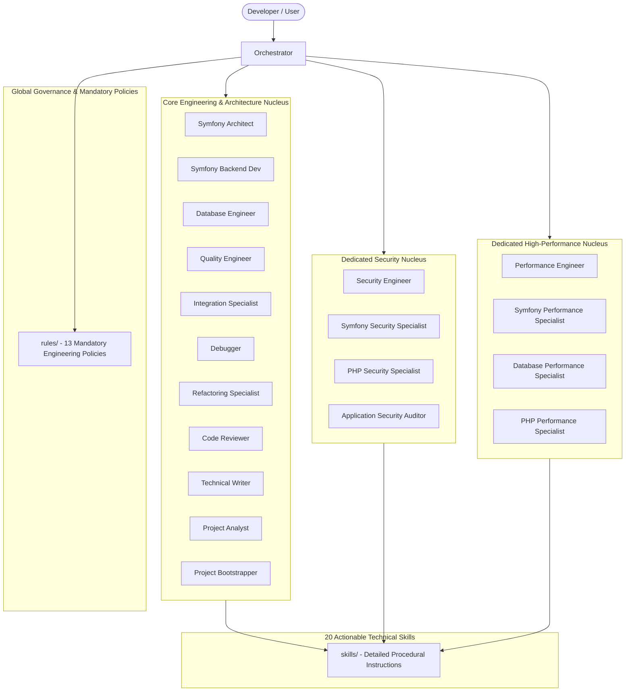
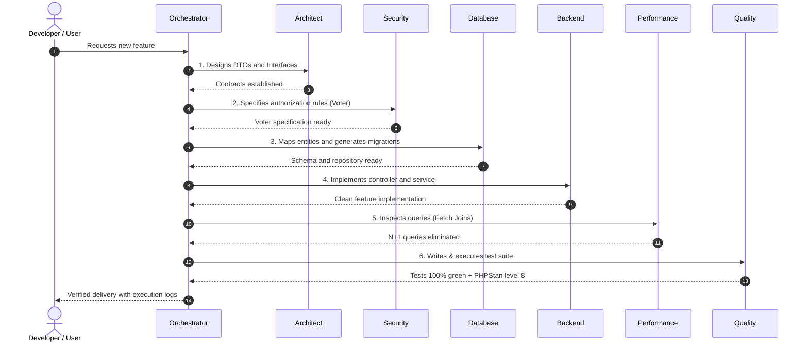

# Symfony Engineering Agent — PHP & Symfony Specialist Ecosystem

> **Autonomous, Collaborative Software Engineering Platform for PHP 8.2+ and Symfony 6.4 LTS / 7.x+**  
> Multi-Agent Architecture featuring 20 Specialized Engineering Agents, 20 Actionable Technical Skills, Strict Quality Gates, OWASP Security Nucleus, and High-Performance Nucleus.

---

## Navigable Table of Contents

1. [Presentation](#1-presentation)
2. [Architectural Overview](#2-architectural-overview)
3. [Directory Structure](#3-directory-structure)
4. [Full Agent Catalog](#4-full-agent-catalog)
5. [Full Skill Catalog](#5-full-skill-catalog)
6. [Relationship Matrix (Agents x Skills)](#6-relationship-matrix-agents-x-skills)
7. [Orchestration Architecture](#7-orchestration-architecture)
8. [Execution Flows and Real-World Scenarios](#8-execution-flows-and-real-world-scenarios)
9. [Installation and Setup in Your AI (Instalação e Configuração na sua IA)](#9-installation-and-setup-in-your-ai-instalação-e-configuração-na-sua-ia)
10. [How to Invoke and Call Agents Using Slash Commands (/)](#10-how-to-invoke-and-call-agents-using-slash-commands-)
11. [Practical Prompt Examples](#11-practical-prompt-examples)
12. [How to Create New Agents](#12-how-to-create-new-agents)
13. [How to Create New Skills](#13-how-to-create-new-skills)
14. [Quality and Mandatory Validations](#14-quality-and-mandatory-validations)
15. [Security and Performance Nuclei](#15-security-and-performance-nuclei)
16. [Troubleshooting](#16-troubleshooting)
17. [Frequently Asked Questions (FAQ)](#17-frequently-asked-questions-faq)
18. [Ecosystem Roadmap](#18-ecosystem-roadmap)

---

## 1. Presentation

### 1.1 What is the Symfony Engineering Agent?
The **Symfony Engineering Agent** is an enterprise-grade artificial intelligence software engineering ecosystem tailored specifically for **PHP and Symfony**. Rather than acting as a generic code-completion snippet generator, it operates as a **coordinated team of senior software engineers**, comprising software architects, backend developers, database engineers, application security specialists, performance engineers, and quality assurance auditors.

### 1.2 What Problem Does It Solve?
Generic AI models consistently introduce software defects when generating PHP and Symfony code:
- They suggest outdated practices (relying on Symfony 4 or 5 patterns rather than modern Symfony 6.4/7+).
- They neglect modern PHP 8.2+ native capabilities (`readonly class`, backed enums, `match` expressions, constructor property promotion).
- They generate "fat controllers" blending presentation, business logic, ORM queries, and HTTP serialization in a single class.
- They introduce critical performance traps, most notably the **N+1 query problem** in Doctrine ORM.
- They leave severe security holes unaddressed (IDOR/BOLA vulnerabilities, missing granular Voters, SQL injection risks, lack of input sanitization).
- They declare tasks complete simply because code was written, without ever verifying if the container compiles, if schemas validate, or if automated tests pass.

The **Symfony Engineering Agent** eliminates these risks by enforcing strict software engineering rules, detailed operational procedures (Skills), and mandatory automated test execution before any delivery is finalized.

### 1.3 Core Mission
Empower developers, engineering teams, and enterprises to build, refactor, audit, optimize, and maintain scalable, secure, and maintainable Symfony applications with 100% adherence to modern standards (PSR-12, PER-CS 2.0, Symfony Best Practices, and OWASP Top 10).

---

## 2. Architectural Overview

The ecosystem enforces a strict separation of concerns among **Governance Policies (`rules/`)**, **Actionable Capabilities (`skills/`)**, **Engineering Roles (`agents/`)**, and **Operational Processes (`workflows/`)**.



### 2.1 Scope Boundaries & Non-Negotiable Rules
1. **Strict Language & Framework Scope:** Exclusively modern PHP 8.2+ and Symfony 6.4 LTS / 7.x+. Never introduces unrequested frameworks or external dependencies without demonstrable technical justification.
2. **Multi-Platform Interoperability:** Native integration across Google Antigravity, Cursor, Claude Code, GitHub Copilot, and command-line environments.
3. **Respect for Existing Codebases:** Always inspects existing conventions (`composer.json`, PSR-4 namespaces, established contracts) before proposing changes. Never refactors out-of-scope code.
4. **Non-Destructive Operations:** Prohibited from executing destructive commands (`doctrine:schema:drop`, `--force`, `rm -rf`) without explicit human authorization.
5. **Mandatory Verification:** No delivery is accepted without local verification evidence (`php bin/console lint:container`, `vendor/bin/phpstan analyse`, and `php bin/phpunit`).

---

## 3. Directory Structure

The repository structure reflects its architectural pillars:

```
symfony-engineering-agent/
├── AGENTS.md                  # Standard multi-agent orchestration entrypoint
├── CATALOG.md                 # Consolidated technical catalog of all resources
├── README.md                  # Master manual and root documentation (this file)
├── CLAUDE.md                  # Claude Code CLI native integration
├── .cursor/
│   └── rules/
│       └── symfony-engineering-agent.mdc  # Cursor IDE rules adapter
├── .github/
│   ├── workflows/
│   │   └── symfony-validation-gates.yml   # Active GitHub Actions PR validation pipeline
│   └── copilot-instructions.md            # GitHub Copilot instructions adapter
├── .claude/
│   └── commands/                          # 11 Claude Code native slash commands
├── plugin.json                # Google Antigravity native plugin manifest
├── install.ps1                # Automated PowerShell installer (Windows)
├── install.sh                 # Automated Bash installer (Linux & macOS)
├── adapters/
│   └── README.md              # Multi-platform setup and integration guide
├── docs/                      # In-depth technical guides and reference manuals
│   ├── AGENTS_GUIDE.md        # Exhaustive specifications for all 20 agents
│   ├── SKILLS_GUIDE.md        # Detailed operational procedures for all 20 skills
│   ├── ORCHESTRATION_SCENARIOS.md # Step-by-step practical orchestration scenarios
│   ├── CI_CD_GATES.md         # Automated CI/CD validation gates guide
│   ├── PROFILER_BENCHMARKS.md # Automated latency, memory & query profiling guide
│   ├── INSTALACAO_IA.md       # Complete installation guide (Portuguese)
│   ├── CONTRIBUTING_EXPANSION.md  # Extension guide for creating new agents & skills
│   ├── ARCHITECTURE.md        # System architecture and technical boundaries
│   └── DECISIONS.md           # Architectural Decision Records (ADRs)
├── rules/                     # 13 Mandatory Global Policies
│   ├── behavior.md            # Autonomous behavior and engineering conduct
│   ├── anti-ai-patterns.md    # Rejection of AI slop, fake implementations, and shortcuts
│   ├── safety-and-autonomy.md # Operational boundaries and safety restrictions
│   ├── git.md                 # Version control conventions and atomic commits
│   ├── php.md                 # Modern PHP 8.2+ and strict typing standards
│   ├── symfony.md             # Modern Symfony 6.4/7+ architectural standards
│   ├── doctrine.md            # Doctrine ORM 3+ mapping and integrity rules
│   ├── database.md            # Relational database and migration conventions
│   ├── performance.md         # Latency budgets, memory management, N+1 query elimination
│   ├── security.md            # OWASP Top 10 mitigation and secure coding policies
│   ├── architecture.md        # Layer separation, dependency inversion, and DTO contracts
│   ├── api.md                 # RESTful API design and RFC 7807/9457 standards
│   └── testing.md             # Automated testing pyramid and static analysis rules
├── agents/                    # 20 Specialized Engineering Roles
│   ├── orchestrator.md
│   ├── symfony-architect.md
│   ├── symfony-backend-developer.md
│   ├── database-engineer.md
│   ├── quality-engineer.md
│   ├── integration-specialist.md
│   ├── debugger.md
│   ├── refactoring-specialist.md
│   ├── code-reviewer.md
│   ├── technical-writer.md
│   ├── project-analyst.md
│   ├── project-bootstrapper.md
│   ├── security-engineer.md
│   ├── symfony-security-specialist.md
│   ├── php-security-specialist.md
│   ├── application-security-auditor.md
│   ├── performance-engineer.md
│   ├── symfony-performance-specialist.md
│   ├── database-performance-specialist.md
│   └── php-performance-specialist.md
├── skills/                    # 20 Standardized Actionable Skills (11 sections each)
│   ├── architecture-design/SKILL.md
│   ├── project-bootstrap/SKILL.md
│   ├── project-discovery/SKILL.md
│   ├── symfony-application/SKILL.md
│   ├── api-design/SKILL.md
│   ├── external-api-integration/SKILL.md
│   ├── doctrine-persistence/SKILL.md
│   ├── testing-quality/SKILL.md
│   ├── debugging/SKILL.md
│   ├── safe-refactoring/SKILL.md
│   ├── code-review/SKILL.md
│   ├── technical-documentation/SKILL.md
│   ├── symfony-security/SKILL.md
│   ├── secure-coding/SKILL.md
│   ├── security-audit/SKILL.md
│   ├── security-review/SKILL.md
│   ├── performance-profiling/SKILL.md
│   ├── symfony-optimization/SKILL.md
│   ├── database-performance/SKILL.md
│   └── php-optimization/SKILL.md
├── workflows/                 # 11 End-to-End Operational Workflows
│   ├── feature-delivery.md
│   ├── create-project.md
│   ├── new-project-delivery.md
│   ├── analyze-project.md
│   ├── bug-fix-delivery.md
│   ├── fix-bug.md
│   ├── code-review.md
│   ├── implement-feature.md
│   ├── integrate-api.md
│   ├── refactor.md
│   └── release-readiness.md
└── templates/                 # Reusable Scaffolding & CI Templates
    ├── ci/                    # Automated CI/CD Pipeline Templates
    │   ├── github/
    │   │   └── symfony-ci.yml # GitHub Actions workflow template
    │   └── gitlab/
    │       └── .gitlab-ci.yml # GitLab CI pipeline template
    ├── benchmarks/            # Automated Profiling & Benchmark Templates
    │   ├── SymfonyProfilerBenchmarkTrait.php # Automated profiling assertions for WebTestCase
    │   ├── benchmark-runner.php   # Standalone CLI benchmark runner (Markdown & JSON)
    │   └── benchmark.json.dist    # Endpoint budgets and configuration template
    ├── architecture.md        # Template for docs/ARCHITECTURE.md
    ├── decisions.md           # Template for ADRs in docs/DECISIONS.md
    ├── implementation-plan.md # Template for implementation plans
    └── implementation-report.md # Template for delivery reports
```

---

## 4. Full Agent Catalog

For complete agent contracts, autonomous capabilities, delegation criteria, and concrete deliverables, refer to the dedicated manual: [docs/AGENTS_GUIDE.md](file:///d:/gow/symfony-engineering-agent-v2.0/symfony-engineering-agent/docs/AGENTS_GUIDE.md).

### 4.1 Core Engineering & Architecture Nucleus

| Agent Name | Technical ID | Instruction File | Primary Responsibility | Associated Skills |
|:---|:---|:---|:---|:---|
| **Orchestrator** | `orchestrator` | `agents/orchestrator.md` | Single point of entry; breaks down tasks, delegates to specialists, and validates deliverables. | `architecture-design`, `project-discovery`, `code-review`, `technical-documentation` |
| **Symfony Architect** | `symfony-architect` | `agents/symfony-architect.md` | Designs hexagonal/clean architecture, establishes DTO contracts, interfaces, and records ADRs. | `architecture-design`, `api-design`, `symfony-application`, `doctrine-persistence` |
| **Symfony Backend Developer** | `symfony-backend-developer` | `agents/symfony-backend-developer.md` | Implements skinny controllers (`#[MapRequestPayload]`), application services, and console commands. | `symfony-application`, `api-design`, `testing-quality`, `debugging` |
| **Database Engineer** | `database-engineer` | `agents/database-engineer.md` | Relational modeling, Doctrine mapping attributes, QueryBuilder repositories, and migrations. | `doctrine-persistence`, `database-performance`, `architecture-design`, `testing-quality` |
| **Quality Engineer** | `quality-engineer` | `agents/quality-engineer.md` | Writes unit and HTTP functional tests (`WebTestCase`), runs PHPStan level 8+ and linters. | `testing-quality`, `code-review`, `debugging`, `security-review` |
| **Integration Specialist** | `integration-specialist` | `agents/integration-specialist.md` | Integrates third-party APIs using `HttpClientInterface`, verifies webhooks HMAC signatures. | `external-api-integration`, `api-design`, `testing-quality`, `symfony-application` |
| **Debugger** | `debugger` | `agents/debugger.md` | Identifies verified root causes, creates automated reproduction regression tests, applies minimal fixes. | `debugging`, `testing-quality`, `performance-profiling`, `code-review` |
| **Refactoring Specialist** | `refactoring-specialist` | `agents/refactoring-specialist.md` | Modernizes legacy code and reduces technical debt while preserving 100% of external contracts. | `safe-refactoring`, `testing-quality`, `architecture-design`, `code-review` |
| **Code Reviewer** | `code-reviewer` | `agents/code-reviewer.md` | Critical inspection of `git diff`, detects AI anti-patterns, verifies strict types and error handling. | `code-review`, `secure-coding`, `security-review`, `testing-quality` |
| **Technical Writer** | `technical-writer` | `agents/technical-writer.md` | Maintains reproducible documentation, OpenAPI endpoint specifications, and records ADRs. | `technical-documentation`, `project-discovery`, `architecture-design`, `api-design` |
| **Project Analyst** | `project-analyst` | `agents/project-analyst.md` | Non-destructive discovery of dependencies, routes, entities, and test setups in existing codebases. | `project-discovery`, `architecture-design`, `code-review`, `technical-documentation` |
| **Project Bootstrapper** | `project-bootstrapper` | `agents/project-bootstrapper.md` | Initializes clean Symfony applications using official skeletons, Symfony Flex, and quality baselines. | `project-bootstrap`, `architecture-design`, `symfony-application`, `testing-quality` |

### 4.2 Dedicated Security Nucleus

| Agent Name | Technical ID | Instruction File | Primary Responsibility | Associated Skills |
|:---|:---|:---|:---|:---|
| **Security Engineer** | `security-engineer` | `agents/security-engineer.md` | Threat modeling, defensive security governance, dependency audits via `composer audit`. | `security-audit`, `symfony-security`, `secure-coding`, `security-review` |
| **Symfony Security Specialist** | `symfony-security-specialist` | `agents/symfony-security-specialist.md` | Configures firewalls in `security.yaml`, granular resource Voters, and native rate limiting. | `symfony-security`, `secure-coding`, `security-audit`, `testing-quality` |
| **PHP Security Specialist** | `php-security-specialist` | `agents/php-security-specialist.md` | OWASP Top 10 mitigation (SQLi, XSS, SSRF, Path Traversal), secure cryptographic hashing. | `secure-coding`, `security-audit`, `security-review`, `testing-quality` |
| **Application Security Auditor** | `application-security-auditor` | `agents/application-security-auditor.md` | Audits endpoints against IDOR/BOLA, verifies multi-tenant isolation and prevents data leaks. | `security-audit`, `security-review`, `symfony-security`, `code-review` |

### 4.3 Dedicated High-Performance Nucleus

| Agent Name | Technical ID | Instruction File | Primary Responsibility | Associated Skills |
|:---|:---|:---|:---|:---|
| **Performance Engineer** | `performance-engineer` | `agents/performance-engineer.md` | Bottleneck profiling via Symfony Profiler/Blackfire, defines latency and memory budgets. | `performance-profiling`, `symfony-optimization`, `database-performance`, `php-optimization` |
| **Symfony Performance Specialist** | `symfony-performance-specialist` | `agents/symfony-performance-specialist.md` | Optimizes DI container, compiles private services, configures cache pools and Messenger. | `symfony-optimization`, `performance-profiling`, `symfony-application`, `database-performance` |
| **Database Performance Specialist** | `database-performance-specialist` | `agents/database-performance-specialist.md` | Eliminates N+1 queries using Fetch Joins (`addSelect`), creates composite indexes, inspects `EXPLAIN`. | `database-performance`, `doctrine-persistence`, `performance-profiling`, `symfony-optimization` |
| **PHP Performance Specialist** | `php-performance-specialist` | `agents/php-performance-specialist.md` | Optimizes algorithm complexity ($O(n)$), implements Generators (`yield`), clears UnitOfWork memory. | `php-optimization`, `performance-profiling`, `safe-refactoring`, `testing-quality` |

---

## 5. Full Skill Catalog

For full technical specifications and code examples for each skill, refer to [docs/SKILLS_GUIDE.md](file:///d:/gow/symfony-engineering-agent-v2.0/symfony-engineering-agent/docs/SKILLS_GUIDE.md).

All 20 skills strictly follow the standardized **11-section format**:
1. *Objective and Responsibility* | 2. *Scope and Limitations* | 3. *Required Technical Knowledge* | 4. *Development Standards and Conventions* | 5. *Architectural Rules and Code Organization* | 6. *PHP and Symfony Best Practices* | 7. *Examples of Correct and Incorrect Implementations* | 8. *Technical Decision Criteria* | 9. *Validation and Testing Procedures* | 10. *Error Handling and Exceptions* | 11. *Objective Quality and Completion Criteria*.

### 5.1 Skill Categories & Structure

```
[Architecture & Initialization]
├── architecture-design        -> Clean architecture boundaries, immutable DTOs, service contracts
├── project-bootstrap          -> Official skeletons, Symfony Flex, baseline linters & configs
└── project-discovery          -> Non-destructive inspection of dependencies, routes, and configs

[Backend & Symfony Application]
├── symfony-application        -> Skinny controllers, #[MapRequestPayload], application services, CLI
├── api-design                 -> RESTful standards, Problem Details RFC 7807/9457, pagination
└── external-api-integration   -> HttpClientInterface, safe retries, HMAC webhook verification

[Persistence & Database Layer]
└── doctrine-persistence       -> Mapping attributes, custom repositories, reversible migrations

[Quality, Testing & Maintenance]
├── testing-quality            -> WebTestCase, isolated unit tests, PHPStan level 8+
├── debugging                  -> Deterministic reproduction, regression test prior to fix
├── safe-refactoring           -> Test-driven refactoring, decoupling without contract breakages
├── code-review                -> Diff inspection, rejection of AI slop and error suppressions
└── technical-documentation    -> Architecture Decision Records (ADRs), OpenAPI specifications

[Security Engineering]
├── symfony-security           -> Stateless firewalls, Authenticators, granular resource Voters
├── secure-coding              -> OWASP Top 10 mitigation, 100% parameterized queries
├── security-audit             -> IDOR/BOLA vulnerability auditing, multi-tenant isolation tests
└── security-review            -> Dependency auditing (composer audit), CVE mitigations

[Performance Engineering]
├── performance-profiling      -> Latency and memory profiling, bottleneck identification
├── symfony-optimization       -> DI container compilation, Redis/APCu cache pools, async Messenger
├── database-performance       -> N+1 elimination via Fetch Joins (addSelect), indexing, EXPLAIN
└── php-optimization           -> Algorithm optimization, memory streaming with Generators (yield)
```

---

## 6. Relationship Matrix (Agents x Skills)

The matrix below illustrates the cross-functional relationships between Agents and Skills:
- **[P] Primary Role:** The skill is fundamental to the agent's core responsibility.
- **[C] Complementary Role:** The skill is utilized for supporting tasks or verification steps.

| Agent | Architecture / Discovery | Backend / API | Doctrine / DB | Testing / Quality | Security / OWASP | Performance / Profiling |
|:---|:---:|:---:|:---:|:---:|:---:|:---:|
| **orchestrator** | **[P]** | **[C]** | **[C]** | **[P]** | **[P]** | **[P]** |
| **symfony-architect** | **[P]** | **[P]** | **[C]** | **[C]** | **[C]** | **[C]** |
| **symfony-backend-developer** | **[C]** | **[P]** | **[C]** | **[P]** | **[C]** | **[C]** |
| **database-engineer** | **[C]** | **[C]** | **[P]** | **[C]** | **[C]** | **[P]** |
| **quality-engineer** | **[C]** | **[C]** | **[C]** | **[P]** | **[C]** | **[C]** |
| **integration-specialist** | **[C]** | **[P]** | **[C]** | **[P]** | **[C]** | **[C]** |
| **debugger** | **[C]** | **[C]** | **[C]** | **[P]** | **[C]** | **[C]** |
| **refactoring-specialist** | **[P]** | **[C]** | **[C]** | **[P]** | **[C]** | **[C]** |
| **code-reviewer** | **[C]** | **[C]** | **[C]** | **[P]** | **[P]** | **[C]** |
| **technical-writer** | **[P]** | **[C]** | - | **[C]** | - | - |
| **project-analyst** | **[P]** | **[C]** | **[C]** | **[C]** | **[C]** | **[C]** |
| **project-bootstrapper** | **[P]** | **[C]** | **[C]** | **[P]** | **[C]** | **[C]** |
| **security-engineer** | **[C]** | - | - | **[C]** | **[P]** | - |
| **symfony-security-specialist** | **[C]** | **[C]** | - | **[C]** | **[P]** | - |
| **php-security-specialist** | - | **[C]** | **[C]** | **[C]** | **[P]** | - |
| **application-security-auditor** | **[C]** | **[C]** | - | **[C]** | **[P]** | - |
| **performance-engineer** | **[C]** | - | **[C]** | **[C]** | - | **[P]** |
| **symfony-performance-specialist** | **[C]** | **[C]** | **[C]** | **[C]** | - | **[P]** |
| **database-performance-specialist** | - | - | **[P]** | **[C]** | - | **[P]** |
| **php-performance-specialist** | **[C]** | **[C]** | - | **[C]** | - | **[P]** |

### 6.1 Conflict-Free Skill Sharing
- **Skills are procedures; Agents are actors:** Multiple agents can execute the same skill (e.g., `testing-quality`), but each applies it within its bounded context. The `symfony-backend-developer` writes functional tests for new endpoints; the `quality-engineer` audits overall test pyramid balance and static analysis coverage.
- **Overlapping Prevention:** The `orchestrator` guarantees that only one agent has write-ownership of a file at any given point during execution.

---

## 7. Orchestration Architecture

### 7.1 How the Ecosystem Assembles the Agent Team
1. **Intake & Scoping:** The `orchestrator` receives the user request and translates it into observable technical acceptance criteria.
2. **Complexity Classification:**
   - *Focused Task (e.g., surgical bug fix):* Engages only `debugger`, `quality-engineer`, and `code-reviewer`.
   - *Architectural Feature (e.g., entity CRUD with database):* Engages `symfony-architect`, `database-engineer`, `symfony-backend-developer`, `database-performance-specialist`, `quality-engineer`, and `application-security-auditor`.
3. **Execution Mode (Sequential vs Subagent):**
   - In platforms with subagent capabilities, the orchestrator delegates tasks providing exact context, allowed file boundaries, and acceptance criteria.
   - In single-agent environments, the orchestrator executes the specialist roles sequentially without simulating external subagent handoffs.
4. **Conflict Resolution:** If a quality or security check fails (e.g., `code-reviewer` detects an unhandled null or `application-security-auditor` identifies an IDOR risk), the implementation is sent back to the responsible specialist for revision prior to presenting results to the user.
5. **Final Consolidation:** Deliverables must contain verified command execution outputs (`php bin/phpunit`, `phpstan analyse`).

---

## 8. Execution Flows and Real-World Scenarios

For complete step-by-step walkthroughs, refer to [docs/ORCHESTRATION_SCENARIOS.md](file:///d:/gow/symfony-engineering-agent-v2.0/symfony-engineering-agent/docs/ORCHESTRATION_SCENARIOS.md).



### Summary of Core Scenarios
1. **Scenario 1 — Complete CRUD in Symfony:** Architect (DTOs), Security (Voter), Database Engineer (Doctrine Mapping & Migration), Backend Developer (Skinny Controller), Database Performance Specialist (Fetch Joins eliminating N+1), and Quality Engineer (`WebTestCase` for 200, 422, and 403).
2. **Scenario 2 — API Latency & N+1 Investigation:** Performance Engineer inspects Symfony Profiler traces, identifies N+1 queries, Database Performance Specialist applies Fetch Joins and composite indexes, dropping response time from 3.5s to under 100ms.
3. **Scenario 3 — Authentication & Authorization with Voters:** Symfony Security Specialist sets up stateless JWT firewall, rate limiting against brute force, and custom Voter. Application Security Auditor verifies IDOR defenses.
4. **Scenario 4 — Safe Legacy Refactoring:** Quality Engineer establishes characterization tests, Refactoring Specialist decouples code via Strategy pattern and modern PHP 8.2+, Code Reviewer confirms zero regression.

---

## 9. Installation and Setup in Your AI (Instalação e Configuração na sua IA)

This section provides the official, step-by-step procedure to install, configure, and execute the Symfony Engineering Agent directly in your AI development environment.

For the Brazilian Portuguese companion guide, see [docs/INSTALACAO_IA.md](file:///d:/gow/symfony-engineering-agent-v2.0/symfony-engineering-agent/docs/INSTALACAO_IA.md).

---

### 9.1 Prerequisites
Before installing, ensure your host environment meets the baseline requirements:
- **PHP 8.2+** available in system PATH (`php -v`).
- **Composer 2.2+** available in system PATH (`composer --version`).
- Required PHP extensions enabled: `pdo`, `ctype`, `iconv`, `json`, `tokenizer`, `xml`, `mbstring`.
- **Git** installed and available in PATH (`git --version`).
- Supported AI environment: Google Antigravity / Gemini CLI, Claude Code CLI, Cursor IDE, GitHub Copilot, Windsurf, or Cline.

---

### 9.2 Download & Git Clone Location
You can clone the repository to any directory on your local machine:
```bash
# Recommended global tools directory:
# On Windows:
cd C:\tools
git clone https://github.com/your-org/symfony-engineering-agent.git

# On Linux / macOS:
cd ~/tools
git clone https://github.com/your-org/symfony-engineering-agent.git
```
> [!IMPORTANT]
> A simple `git clone` alone does not automatically register agents in your AI tool. You must either point your AI tool to this directory, install it globally, or integrate it into your Symfony project using the instructions below.

---

### 9.3 Correct Installation Directories by AI Platform

| AI Platform | Installation Scope | Target Directory on Windows | Target Directory on Linux / macOS |
|:---|:---|:---|:---|
| **Google Antigravity / Gemini CLI** | **Global (All Projects)** | `%USERPROFILE%\.gemini\config\plugins\symfony-engineering-agent\` and `%USERPROFILE%\.gemini\config\skills\` | `~/.gemini/config/plugins/symfony-engineering-agent/` and `~/.gemini/config/skills/` |
| **Google Antigravity / Gemini CLI** | **Project-Specific** | `<project-root>\.agents\` and `<project-root>\AGENTS.md` | `<project-root>/.agents/` and `<project-root>/AGENTS.md` |
| **Claude Code CLI** | **Global Slash Commands** | `%USERPROFILE%\.claude\commands\` | `~/.claude/commands/` |
| **Claude Code CLI** | **Project-Specific** | `<project-root>\CLAUDE.md` and `<project-root>\.claude\commands\` | `<project-root>/CLAUDE.md` and `<project-root>/.claude/commands/` |
| **Cursor IDE** | **Project-Specific** | `<project-root>\.cursor\rules\symfony-engineering-agent.mdc` | `<project-root>/.cursor/rules/symfony-engineering-agent.mdc` |
| **GitHub Copilot** | **Project-Specific** | `<project-root>\.github\copilot-instructions.md` | `<project-root>/.github/copilot-instructions.md` |

---

### 9.4 Automated Installation Scripts (`install.ps1` & `install.sh`)

We provide automated cross-platform installation scripts that handle folder creation, file copying, and slash command registration in a single step:

#### On Windows (PowerShell)
```powershell
cd symfony-engineering-agent

# Option A: Install GLOBALLY for Google Antigravity and Claude Code:
.\install.ps1 -Global

# Option B: Install into an existing Symfony application:
.\install.ps1 -TargetProject "C:\path\to\my-symfony-app"
```

#### On Linux & macOS (Bash)
```bash
cd symfony-engineering-agent
chmod +x install.sh

# Option A: Install GLOBALLY for Google Antigravity and Claude Code:
./install.sh --global

# Option B: Install into an existing Symfony application:
./install.sh --target-project /path/to/my-symfony-app
```

---

### 9.5 AI Tool Discovery & Agent Recognition
- **How Antigravity Discovers Agents & Skills:** Antigravity traverses the project tree looking for `.agents/` or global plugins in `~/.gemini/config/plugins/`. It parses `AGENTS.md` as the master agent roster and registers each directory containing `SKILL.md` with YAML frontmatter as an active skill.
- **How Claude Code Discovers Commands:** Claude Code reads `CLAUDE.md` in the current working directory and automatically registers every `.md` file in `~/.claude/commands/` or `.claude/commands/` as an executable slash command (`/<filename>`).
- **How Cursor Discovers Rules:** Cursor continuously indexes `.cursor/rules/*.mdc` files and applies them whenever a matching file glob is edited.
- **Is Restart Required?** Claude Code loads slash commands immediately on your next command or session. For Antigravity and Cursor, reopening the chat window or restarting the CLI refreshes the autocomplete command index.

---

### 9.6 Availability of Skills & Slash Commands
Every skill in `skills/` and command in `.claude/commands/` is equipped with standardized metadata. Once installed, your AI chat input box will automatically suggest the commands when you type `/`.

---

## 10. How to Invoke and Call Agents Using Slash Commands (`/`)

You can execute any specialist agent or skill using dedicated slash commands (`/<command>`).

### 10.1 Complete Catalog of Available Slash Commands

| Slash Command | Agent Invoked | Skills Injected | Purpose | Syntax | Example Prompt | Expected Deliverable |
|:---|:---|:---|:---|:---|:---|:---|
| **/symfony** | `orchestrator` | `architecture-design`, `project-discovery`, `code-review` | End-to-end task planning, multi-agent coordination, and delivery validation. | `/symfony <request>` | `/symfony Build customer subscription module with API, DB, and tests.` | Clean feature implementation with tests passing and container verified. |
| **/architecture** | `symfony-architect` | `architecture-design`, `api-design` | Software architecture, hexagonal boundaries, immutable DTOs, ADRs. | `/architecture <request>` | `/architecture Design order cancellation flow with request/response DTOs.` | Typed DTOs, service interfaces, ADR in `docs/DECISIONS.md`. |
| **/backend** | `symfony-backend-developer` | `symfony-application`, `testing-quality` | Skinny controllers (`#[MapRequestPayload]`), services, CLI commands. | `/backend <request>` | `/backend Implement POST /api/coupons endpoint with validation.` | Final controller, application service, and `WebTestCase`. |
| **/doctrine** | `database-engineer` | `doctrine-persistence`, `database-performance` | Entity modeling, mapping attributes, repositories, migrations. | `/doctrine <request>` | `/doctrine Map Invoice and InvoiceItem entities and generate migration.` | Strictly mapped entities, repository methods, schema migration. |
| **/tests** | `quality-engineer` | `testing-quality`, `code-review` | Unit tests, `WebTestCase` functional suites, PHPStan level 8+. | `/tests <request>` | `/tests Write functional tests covering 201, 422, and 403 on /api/orders.` | Executed test suite with PHPUnit execution logs. |
| **/security** | `symfony-security-specialist`, `php-security-specialist` | `symfony-security`, `secure-coding` | Symfony Voters, stateless firewalls, rate limiters, OWASP defense. | `/security <request>` | `/security Create ProjectVoter to ensure only project members can edit.` | Voter class in `src/Security/Voter/` and 401/403 tests. |
| **/performance**| `performance-engineer`, `database-performance-specialist`| `performance-profiling`, `database-performance` | N+1 query elimination (Fetch Joins), indexes, async Messenger. | `/performance <request>` | `/performance Eliminate N+1 queries in OrderRepository::findAllWithItems().` | Refactored QueryBuilder with `addSelect()` and benchmark proof. |
| **/audit** | `application-security-auditor`, `security-engineer` | `security-audit`, `security-review` | Endpoint auditing for IDOR/BOLA, tenant isolation, `composer audit`. | `/audit <request>` | `/audit Audit /api/invoices/{id} for IDOR across different tenants.` | Security audit report with proof-of-concept tests. |
| **/debug** | `debugger` | `debugging`, `testing-quality` | Stack trace analysis, regression test before fix, atomic patch. | `/debug <request>` | `/debug Fix null pointer exception in StripeWebhookHandler.` | Reproduction test passing after atomic patch. |
| **/refactor** | `refactoring-specialist` | `safe-refactoring`, `testing-quality` | Modernize legacy code, Strategy pattern, PHP 8.2+ without regression. | `/refactor <request>` | `/refactor Modernize PaymentProcessor using Strategy pattern.` | Decoupled classes, 100% passing regression test suite. |
| **/review** | `code-reviewer` | `code-review`, `secure-coding` | Critical diff inspection against AI slop, strict typing, and regressions. | `/review <request>` | `/review Audit git diff before creating pull request.` | Review report with findings categorized by severity. |

---

### 10.2 Daily Practical Usage Workflows

#### 1. Individual Execution
```text
/backend Create a complete CRUD for product categories following our project architecture.
```

#### 2. Specialized Database & Performance Execution
```text
/doctrine Analyze our entity relationships in Order and OrderItem and identify missing composite indexes.
```
```text
/performance Inspect all queries executed on GET /api/orders and eliminate N+1 query traps using Fetch Joins.
```

#### 3. Security Audit & Hardening
```text
/security Create an InvoiceVoter ensuring only the invoice owner or users with ROLE_FINANCE can trigger payments.
```
```text
/audit Audit all parameterized routes (/api/*/{id}) for IDOR vulnerabilities and run composer audit for CVEs.
```

#### 4. Automatic Multi-Agent Orchestration
```text
/symfony Implement a complete customer management module, including PostgreSQL database migrations, REST API endpoints, Symfony Validator constraints, authorization Voters, and PHPUnit functional tests.
```
*In this scenario, the Orchestrator autonomously assigns tasks to the Architect, Database Engineer, Backend Developer, Security Specialist, Performance Specialist, and Quality Engineer.*

---

### 10.3 How to Update the Ecosystem
When updates or new skills are pushed to the GitHub repository:
```bash
# 1. Pull latest changes
cd symfony-engineering-agent
git pull origin main

# 2. Re-run installer to refresh global or project files:
# On Windows:
.\install.ps1 -Global
# On Linux / macOS:
./install.sh --global
```

---

### 10.4 Installation Verification Test & Troubleshooting

To confirm that your installation was successful and all agents are active:

1. **Verify Slash Commands in Chat:**
   Open your AI chat input box and type `/`. Verify that `/symfony`, `/backend`, `/doctrine`, `/security`, `/performance`, `/tests` appear in the autocomplete list.
2. **Execute Diagnostic Smoke Test:**
   Type the following prompt into your AI chat:
   ```text
   /backend State your role, primary responsibility, and which skills you use.
   ```
   **Expected Result:** The AI immediately assumes the persona of the **Symfony Backend Developer**, cites `skills/symfony-application`, and confirms adherence to skinny controllers, strict typing, and DTOs.
3. **Troubleshooting Tips:**
   - *Commands not appearing in Claude Code:* Ensure `~/.claude/commands` contains the `.md` files. Run `/help` in Claude Code to refresh command index.
   - *Commands not appearing in Antigravity:* Verify that `.gemini/config/skills` or `.agents/skills` contains the skill folders. Restart the Antigravity window.
   - *Execution policy error on Windows (`install.ps1`):* Run `Set-ExecutionPolicy -Scope Process -ExecutionPolicy Bypass` in your PowerShell window and re-run.

---

## 11. Practical Prompt Examples

Copy and paste these ready-to-use prompts to trigger the ecosystem with maximum effectiveness:

#### 1. Implement a complete new endpoint with persistence
```text
Act as the Orchestrator of the Symfony Engineering Agent.
Implement an endpoint POST /api/v1/invoices for customer invoicing.
Requirements:
- Input DTO strictly validated with Symfony Validator constraints.
- Doctrine persistence with Invoice entity and InvoiceItem relationships.
- Granular authorization ensuring users can only invoice for their own organization.
- Functional test covering success (201), validation failure (422), and access denied (403).
- Validate everything by running local container linters and tests.
```

#### 2. Investigate API latency and N+1 queries
```text
Act as the Database Performance Specialist of the Symfony Engineering Agent.
The endpoint GET /api/v1/projects is experiencing high latency when listing more than 100 items.
Inspect ProjectRepository, verify N+1 query occurrences, apply Fetch Joins, and verify composite index requirements.
Ensure all existing tests continue passing without regression.
```

#### 3. Complete pre-release security audit
```text
Act as the Application Security Auditor and Security Engineer of the Symfony Engineering Agent.
Perform a thorough security audit on the Order module.
Specifically verify:
- Presence of IDOR vulnerabilities on /api/orders/{id}.
- Protection of sensitive endpoints with appropriate Voters.
- Run composer audit to detect CVEs in third-party dependencies.
- Provide a formal audit report with proof of compliance.
```

#### 4. Refactor legacy service
```text
Act as the Refactoring Specialist of the Symfony Engineering Agent.
Refactor the legacy service in src/Service/PaymentService.php.
Ensure:
1. Establish characterization tests prior to any modification if coverage is insufficient.
2. Apply the Strategy design pattern for payment gateway integrations.
3. Use modern PHP 8.2+ features (readonly class, match, native enums).
4. Prove that the test suite remains 100% green after refactoring.
```

---

## 12. How to Create New Agents

For step-by-step instructions and templates, refer to [docs/CONTRIBUTING_EXPANSION.md](file:///d:/gow/symfony-engineering-agent-v2.0/symfony-engineering-agent/docs/CONTRIBUTING_EXPANSION.md).

### Summary of Agent Creation:
1. Create the markdown file under `agents/<technical-id>.md`.
2. Follow the mandatory **6-section structure**:
   - `## 1. Primary Responsibility`
   - `## 2. Specialized Technical Knowledge`
   - `## 3. Associated Skills`
   - `## 4. Operational Capabilities`
   - `## 5. Delegation Criteria`
   - `## 6. Handoff & Deliverables`
3. Register the agent in `AGENTS.md` and `CATALOG.md`.
4. Update the [Relationship Matrix](#6-relationship-matrix-agents-x-skills) in this README.

---

## 13. How to Create New Skills

### Summary of Skill Creation:
1. Create the directory under `skills/<technical-id>/` and the file `SKILL.md`.
2. Follow the mandatory **11-section structure**:
   - `## 1. Objective and Responsibility`
   - `## 2. Scope and Limitations`
   - `## 3. Required Technical Knowledge`
   - `## 4. Development Standards and Conventions`
   - `## 5. Architectural Rules and Code Organization`
   - `## 6. PHP and Symfony Best Practices`
   - `## 7. Examples of Correct and Incorrect Implementations`
   - `## 8. Technical Decision Criteria`
   - `## 9. Validation and Testing Procedures`
   - `## 10. Error Handling and Exceptions`
   - `## 11. Objective Quality and Completion Criteria`
3. Register the new skill in `CATALOG.md` and associate it with relevant agents.

---

## 14. Quality and Mandatory Validations

### 14.1 Mandatory Baseline Validations
No task that introduces or modifies PHP or Symfony code is complete without passing:

```bash
# 1. Container integrity and route validation
php bin/console lint:container
php bin/console lint:yaml config

# 2. Doctrine mapping and schema synchronization
php bin/console doctrine:schema:validate

# 3. Static analysis with zero errors
vendor/bin/phpstan analyse src tests --level=8

# 4. Automated test suite execution
php bin/phpunit
```

### 14.2 Conditional Validations
- **Package modifications (`composer.json`):** `composer validate` and `composer audit`.
- **HTTP endpoint creation:** Functional test via `WebTestCase` covering success (200/201), validation failure (422), and forbidden access (401/403).
- **ORM queries loading relationships:** Verification by `database-performance-specialist` confirming Fetch Joins (`addSelect`).

### 14.3 Automated CI/CD Pipeline Gates (GitHub Actions & GitLab CI)
To enforce these quality gates automatically on every Pull Request, the repository provides production-ready CI/CD workflow templates:
- **GitHub Actions Pipeline:** [.github/workflows/symfony-validation-gates.yml](file:///d:/gow/symfony-engineering-agent-v2.0/symfony-engineering-agent/.github/workflows/symfony-validation-gates.yml) and [templates/ci/github/symfony-ci.yml](file:///d:/gow/symfony-engineering-agent-v2.0/symfony-engineering-agent/templates/ci/github/symfony-ci.yml).
- **GitLab CI Pipeline:** [templates/ci/gitlab/.gitlab-ci.yml](file:///d:/gow/symfony-engineering-agent-v2.0/symfony-engineering-agent/templates/ci/gitlab/.gitlab-ci.yml).
- **Comprehensive CI/CD Manual:** Refer to [docs/CI_CD_GATES.md](file:///d:/gow/symfony-engineering-agent-v2.0/symfony-engineering-agent/docs/CI_CD_GATES.md) for installation, PostgreSQL service containers, PHP 8.2/8.3 matrix testing, and branch protection rules.

---

## 15. Security and Performance Nuclei

### 15.1 Security Nucleus (OWASP & Symfony Security)
- **Granular Authorization (Voters):** Endpoints manipulating resources by ID (`/api/projects/{id}`) must invoke `$this->denyAccessUnlessGranted('PROJECT_EDIT', $project)`.
- **Strict Input Validation:** Untrusted input is strictly validated via typed DTOs with Symfony Validator constraints.
- **Injection Defense:** 100% of database queries use bound parameters (`:param`). Concatenation in SQL or DQL is strictly prohibited.
- **IDOR Prevention:** Verification by `application-security-auditor` confirming cross-tenant data isolation.
- **Automated SAST & CVE Remediation:** Static Application Security Testing with Semgrep custom rules (`templates/security/semgrep.yaml.dist`, `sast-scanner.php`) and automated 5-phase dependency CVE remediation (`cve-remediator.php`, [docs/SAST_AND_CVE_REMEDIATION.md](file:///d:/gow/symfony-engineering-agent-v2.0/symfony-engineering-agent/docs/SAST_AND_CVE_REMEDIATION.md)).

### 15.2 High-Performance Nucleus
- **Zero Tolerance for N+1 Queries:** Repositories must utilize Fetch Joins in Doctrine QueryBuilder when child entities are accessed.
- **Asynchronous Execution:** High-latency operations (notifications, emails, remote HTTP calls) are dispatched via Symfony Messenger.
- **Memory Streaming:** Batch data operations utilize PHP Generators (`yield`) and `$entityManager->clear()` to maintain low, predictable memory footprints.
- **Automated Profiler Benchmarks:** The ecosystem includes `SymfonyProfilerBenchmarkTrait` and `benchmark-runner.php` to mathematically assert latency (< 150ms), peak memory (< 24MB), and zero duplicate queries directly in functional tests and CI/CD pipelines (see [docs/PROFILER_BENCHMARKS.md](file:///d:/gow/symfony-engineering-agent-v2.0/symfony-engineering-agent/docs/PROFILER_BENCHMARKS.md)).

---

## 16. Troubleshooting

### 16.1 `lint:container` Failure (Service Not Found or Invalid Injection)
- **Common Cause:** Untyped constructor parameter or missing autowiring rule.
- **Resolution:** Verify `config/services.yaml`, ensure the class resides under `App\` namespace, and verify all injected parameters have explicit interface or class types.

### 16.2 `doctrine:schema:validate` Failure (Schema Out of Sync)
- **Common Cause:** Entity mapping modified without generating a corresponding migration.
- **Resolution:** Run `php bin/console doctrine:migrations:diff`, inspect the generated migration, and apply via `php bin/console doctrine:migrations:migrate`.

### 16.3 PHPStan Generic Type Errors (Level 8)
- **Common Cause:** Missing generic type PHPDocs on Doctrine collections (`Collection<int, OrderItem>`).
- **Resolution:** Add generic PHPDocs above the property:
  ```php
  /** @var Collection<int, OrderItem> */
  #[ORM\OneToMany(targetEntity: OrderItem::class, mappedBy: 'order')]
  private Collection $items;
  ```

---

## 17. Frequently Asked Questions (FAQ)

#### Q: Does the Symfony Engineering Agent replace human software engineers?
**A:** No. It serves as an autonomous engineering accelerator, operating as an advisory and executing technical team under human supervision. High-level architecture decisions and production deployments remain with human engineers.

#### Q: Can it be used in legacy Symfony 5.4 or earlier projects?
**A:** The ecosystem strictly targets **PHP 8.2+ and Symfony 6.4 LTS / 7.x+**. When introduced to earlier versions, the agents will recommend and plan modernization steps before applying modern patterns.

#### Q: How does the ecosystem prevent hallucinations and invalid API calls?
**A:** Through mandatory **Automated Local Verification**. No implementation is marked complete without passing container linting, static analysis, and automated test suite execution.

---

## 18. Ecosystem Roadmap

- [x] **v1.0:** Foundation architecture with 12 core agents and 12 skills.
- [x] **v2.0:** Dedicated Security Nucleus (4 agents) and High-Performance Nucleus (4 agents), totaling 20 specialized agents and 20 standardized skills.
- [x] **v2.1:** Exhaustive global documentation restructuring with supplementary reference guides in `docs/`.
- [x] **v2.2:** Multi-platform installation and direct agent invocation guide added to master manual.
- [x] **v2.3:** Automated CI/CD workflow templates for GitHub Actions and GitLab CI running agent validation gates on Pull Requests (see [docs/CI_CD_GATES.md](file:///d:/gow/symfony-engineering-agent-v2.0/symfony-engineering-agent/docs/CI_CD_GATES.md) and `templates/ci/`).
- [x] **v2.4:** Automated latency and memory profiling integration with Symfony Profiler benchmarks (see [docs/PROFILER_BENCHMARKS.md](file:///d:/gow/symfony-engineering-agent-v2.0/symfony-engineering-agent/docs/PROFILER_BENCHMARKS.md) and `templates/benchmarks/`).
- [x] **v2.5:** Automated OpenAPI/Swagger contract generation and schema regression test harnesses (see [docs/OPENAPI_CONTRACT_TESTING.md](file:///d:/gow/symfony-engineering-agent-v2.0/symfony-engineering-agent/docs/OPENAPI_CONTRACT_TESTING.md) and `templates/contracts/`).
- [x] **v2.6:** Mutation testing integration with Infection PHP and automated architectural boundary enforcement with Deptrac (see [docs/MUTATION_TESTING.md](file:///d:/gow/symfony-engineering-agent-v2.0/symfony-engineering-agent/docs/MUTATION_TESTING.md), [docs/ARCHITECTURAL_BOUNDARIES.md](file:///d:/gow/symfony-engineering-agent-v2.0/symfony-engineering-agent/docs/ARCHITECTURAL_BOUNDARIES.md), `templates/testing/`, and `templates/architecture/`).
- [x] **v2.7:** Automated load and stress testing harnesses with k6 and asynchronous worker scaling verification with Symfony Messenger (see [docs/LOAD_AND_STRESS_TESTING.md](file:///d:/gow/symfony-engineering-agent-v2.0/symfony-engineering-agent/docs/LOAD_AND_STRESS_TESTING.md), [docs/ASYNC_MESSENGER_SCALING.md](file:///d:/gow/symfony-engineering-agent-v2.0/symfony-engineering-agent/docs/ASYNC_MESSENGER_SCALING.md), `templates/load-testing/`, and `templates/messenger/`).
- [x] **v2.8:** Static Application Security Testing (SAST) with Semgrep and automated OWASP dependency CVE remediation workflows (see [docs/SAST_AND_CVE_REMEDIATION.md](file:///d:/gow/symfony-engineering-agent-v2.0/symfony-engineering-agent/docs/SAST_AND_CVE_REMEDIATION.md), [workflows/cve-remediation.md](file:///d:/gow/symfony-engineering-agent-v2.0/symfony-engineering-agent/workflows/cve-remediation.md), and `templates/security/`).
- [ ] **v2.9 (Upcoming):** Automated containerization with Docker, FrankenPHP/RoadRunner Caddyfiles, and multi-stage production builds.

---

## License & Governance

Distributed under the MIT License. Refer to `rules/` for mandatory governance policies and `docs/` for deep-dive technical manuals.
