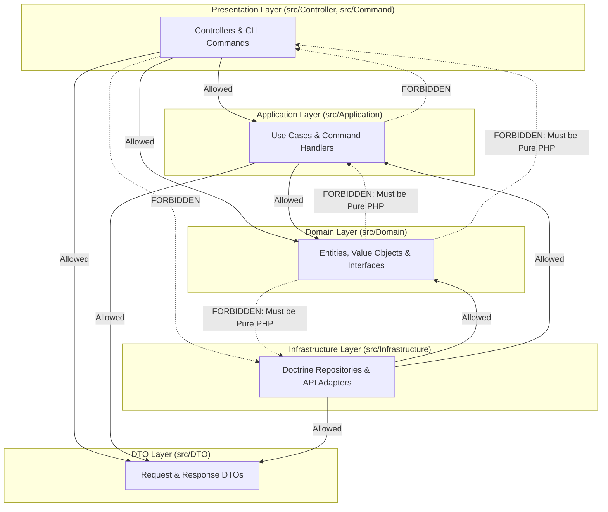

# Architectural Boundary Enforcement with Deptrac in Symfony

The **Symfony Engineering Agent** enforces strict architectural layer boundaries using **Deptrac** and automated static analysis.

Without automated architectural boundary gates, modern software systems inevitably decay into tightly coupled monoliths ("Big Ball of Mud"):
- Domain entities become directly coupled to HTTP controllers or external SDKs.
- HTTP Controllers directly execute Doctrine ORM queries and instantiate third-party API clients, bypassing Application services.
- Circular dependencies develop between Infrastructure and Application layers, making unit testing and framework upgrades nearly impossible.

---

## 1. Hexagonal & Clean Architecture Layers

The ecosystem enforces a 5-layer separation of concerns based on Hexagonal Architecture (Ports and Adapters):



---

## 2. Layer Dependency Ruleset

| Source Layer | Allowed Dependencies | Prohibited Dependencies | Reason |
| :--- | :--- | :--- | :--- |
| **Domain** | *(None: Pure PHP)* | `Application`, `Infrastructure`, `Presentation`, `DTO` | Domain must remain 100% agnostic to frameworks, databases, and delivery mechanisms. |
| **Application** | `Domain`, `DTO` | `Infrastructure`, `Presentation` | Use cases depend only on domain entities and repository interfaces; never on concrete infrastructure implementations. |
| **Infrastructure** | `Domain`, `Application`, `DTO` | `Presentation` | Infrastructure implements ports and interfaces defined in Domain and Application. |
| **Presentation** | `Application`, `Domain`, `DTO` | `Infrastructure` | Controllers must interact through Application use cases; direct coupling to infrastructure is strictly forbidden. |
| **DTO** | `Domain` | `Infrastructure`, `Application`, `Presentation` | DTOs are lightweight data carriers and must not depend on runtime services or infrastructure. |

---

## 3. Configuration Template: `deptrac.yaml.dist`

The reference configuration resides in [templates/architecture/deptrac.yaml.dist](file:///d:/gow/symfony-engineering-agent-v2.0/symfony-engineering-agent/templates/architecture/deptrac.yaml.dist):

```yaml
deptrac:
  paths:
    - src/
  exclude_files:
    - '#.*test.*#'
    - '#.*Kernel\.php#'
    - '#.*Migrations/.*#'

  layers:
    - name: Domain
      collectors:
        - type: directory
          value: src/Domain/.*
        - type: classNameRegex
          regex: '#^App\\Domain\\.*#'

    - name: Application
      collectors:
        - type: directory
          value: src/Application/.*
        - type: classNameRegex
          regex: '#^App\\Application\\.*#'

    - name: Infrastructure
      collectors:
        - type: directory
          value: src/Infrastructure/.*
        - type: classNameRegex
          regex: '#^App\\Infrastructure\\.*#'

    - name: Presentation
      collectors:
        - type: directory
          value: src/(Controller|Command|Presentation)/.*
        - type: classNameRegex
          regex: '#^App\\(Controller|Command|Presentation)\\.*#'

    - name: DTO
      collectors:
        - type: directory
          value: src/DTO/.*
        - type: classNameRegex
          regex: '#^App\\DTO\\.*#'

  ruleset:
    Domain: []
    Application:
      - Domain
      - DTO
    Infrastructure:
      - Domain
      - Application
      - DTO
    Presentation:
      - Application
      - Domain
      - DTO
    DTO:
      - Domain
```

---

## 4. Architectural Boundary Validator (`architecture-validator.php`)

The CLI script [templates/architecture/architecture-validator.php](file:///d:/gow/symfony-engineering-agent-v2.0/symfony-engineering-agent/templates/architecture/architecture-validator.php) runs official Deptrac if installed or falls back to an integrated static dependency scanner.

### 4.1 CLI Usage

```bash
php templates/architecture/architecture-validator.php [options]
```

### 4.2 Available Options

| Option | Description |
| :--- | :--- |
| `-h`, `--help` | Display usage and parameters. |
| `--config=<file>` | Path to custom `deptrac.yaml` configuration. |
| `--path=<dir>` | Source directory to inspect (default: `src/`). |
| `--output-json=<file>` | Save structured violation report as JSON. |
| `--strict` | Enforce zero tolerance on warnings. |

### 4.3 Output Example: Successful Validation

```
====================================================================
  Symfony Engineering Agent — Architectural Boundary Validator
====================================================================
Configuration:      templates/architecture/deptrac.yaml.dist
Source Directory:   src
Strict Mode:        ENABLED

Architectural Analysis Summary:
  - Files Inspected:       48
  - Violations Detected:   0

Result: PASSED — Architectural boundaries clean and verified!
```

### 4.4 Output Example: Boundary Violation Detected

When a developer inadvertently imports an infrastructure repository directly into a Domain entity:

```
### Architectural Boundary Violations Detected:

| File | Line | Source Layer | Forbidden Target | Import |
|:---|:---:|:---:|:---:|:---|
| src/Domain/Entity/Project.php | 14 | Domain | Infrastructure | `App\Infrastructure\Repository\DoctrineProjectRepository` |
| src/Controller/ProjectController.php | 22 | Presentation | Infrastructure | `App\Infrastructure\Mailer\SesEmailSender` |

Result: FAILED — Prohibited layer dependencies detected violating Hexagonal Architecture!
```

---

## 5. Remediation Patterns

### 5.1 Inversion of Control with Repository Interfaces

**Violation:** Domain or Controller directly depends on `DoctrineProjectRepository`.

**Remedy:**
1. Define interface in `src/Domain/Repository/ProjectRepositoryInterface.php`:
   ```php
   namespace App\Domain\Repository;

   interface ProjectRepositoryInterface
   {
       public function findById(int $id): ?Project;
   }
   ```
2. Implement in `src/Infrastructure/Repository/DoctrineProjectRepository.php`:
   ```php
   namespace App\Infrastructure\Repository;

   use App\Domain\Repository\ProjectRepositoryInterface;

   final class DoctrineProjectRepository implements ProjectRepositoryInterface
   {
       // ...
   }
   ```
3. Typehint the **Interface** in Application use cases.

---

## 6. Continuous Integration (CI/CD) Gate

Incorporate architectural validation into `.github/workflows/symfony-ci.yml`:

```yaml
- name: 🏛️ Validate Architectural Boundaries (Deptrac)
  run: php templates/architecture/architecture-validator.php --strict
```
