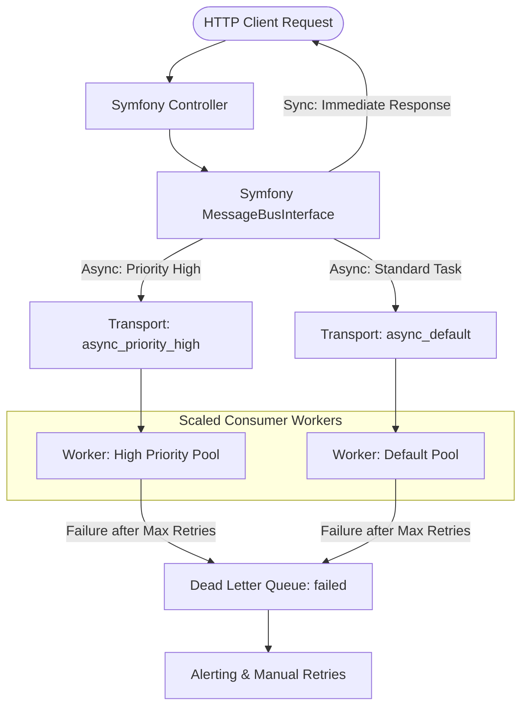

# Asynchronous Worker Scaling & Queue Verification with Symfony Messenger

The **Symfony Engineering Agent** enforces strict asynchronous processing standards and queue worker reliability through **Symfony Messenger** and automated configuration audits.

Executing long-running tasks synchronously within HTTP request cycles degrades application responsiveness, inflates P95/P99 latency percentiles, and causes cascading timeout failures when downstream dependencies experience latency.

---

## 1. Asynchronous Architecture & Queue Topology

The ecosystem enforces a tiered queue topology in Symfony applications:



| Transport | Role | Retry Policy | Intended Payloads |
| :--- | :--- | :--- | :--- |
| **`async_priority_high`** | Urgent asynchronous jobs | 5 retries, 500ms initial delay, 2x multiplier | Password resets, 2FA tokens, payment webhooks. |
| **`async_default`** | Standard background processing | 3 retries, 1s initial delay, 2x multiplier | Marketing emails, PDF generation, bulk exports. |
| **`failed` (DLQ)** | Poison message quarantine | 0 retries (Storage only) | Messages that failed all retry attempts. |

---

## 2. Configuration Standards (`messenger.yaml.dist`)

The reference configuration in [templates/messenger/messenger.yaml.dist](file:///d:/gow/symfony-engineering-agent-v2.0/symfony-engineering-agent/templates/messenger/messenger.yaml.dist) mandates:
1. **Mandatory Failure Transport:** Every production system MUST define a dead-letter queue (`failure_transport: failed`) to prevent silent message loss.
2. **Explicit Exponential Backoff:** All async transports must configure `max_retries`, `delay`, `multiplier`, and `max_delay` to prevent worker thundering herds.
3. **Decoupled Core Notifications:** `SendEmailMessage`, `ChatMessage`, and `SmsMessage` must be explicitly routed to async transports.

```yaml
framework:
  messenger:
    failure_transport: failed

    transports:
      async_priority_high:
        dsn: '%env(MESSENGER_TRANSPORT_DSN)%?queue_name=high'
        retry_strategy:
          max_retries: 5
          delay: 500
          multiplier: 2
          max_delay: 5000

      async_default:
        dsn: '%env(MESSENGER_TRANSPORT_DSN)%?queue_name=default'
        retry_strategy:
          max_retries: 3
          delay: 1000
          multiplier: 2
          max_delay: 10000

      failed:
        dsn: 'doctrine://default?queue_name=failed'

    routing:
      'App\Message\HighPriorityMessageInterface': async_priority_high
      'App\Message\AsyncMessageInterface': async_default
      'Symfony\Component\Mailer\Messenger\SendEmailMessage': async_default
```

---

## 3. Worker Management & Scaling Patterns

### 3.1 Supervisor Configuration (`/etc/supervisor/conf.d/messenger.conf`)

In production environments, daemonize workers using Supervisor to handle automatic restarts and process recycling:

```ini
[program:messenger-consume-high]
command=php /var/www/html/bin/console messenger:consume async_priority_high --limit=1000 --time-limit=3600 --memory-limit=128M
numprocs=2
autostart=true
autorestart=true
process_name=%(program_name)s_%(process_num)02d
user=www-data

[program:messenger-consume-default]
command=php /var/www/html/bin/console messenger:consume async_default --limit=500 --time-limit=3600 --memory-limit=256M
numprocs=4
autostart=true
autorestart=true
process_name=%(program_name)s_%(process_num)02d
user=www-data
```

### 3.2 Graceful Worker Restarts on Deployment

Always stop workers cleanly during code deployments so they consume updated bytecode:

```bash
php bin/console messenger:stop-workers
```

---

## 4. Using the Messenger Worker Verifier (`messenger-worker-verifier.php`)

The CLI script in [templates/messenger/messenger-worker-verifier.php](file:///d:/gow/symfony-engineering-agent-v2.0/symfony-engineering-agent/templates/messenger/messenger-worker-verifier.php) audits Messenger configuration files:

### 4.1 CLI Syntax

```bash
php templates/messenger/messenger-worker-verifier.php [options]
```

### 4.2 Available Options

| Option | Description |
| :--- | :--- |
| `-h`, `--help` | Show command usage and options. |
| `--config=<file>` | Path to custom `messenger.yaml` file. |
| `--check-stats` | Inspect live queue depths via `messenger:stats`. |
| `--check-failed` | Inspect unhandled dead-letter messages via `messenger:failed:show`. |
| `--strict` | Enforce zero tolerance for synchronous blockers or missing DLQs. |
| `--output-json=<file>` | Save structured audit findings as JSON. |

### 4.3 Output Example: Successful Audit

```
====================================================================
  Symfony Engineering Agent — Messenger Worker & Queue Verifier
====================================================================
Configuration:      templates/messenger/messenger.yaml.dist
Strict Mode:        ENABLED

### Messenger Configuration & Worker Audit Summary

| Transport Name | Queue Role | Max Retries | Status |
|:---|:---:|:---:|:---:|
| async_priority_high | Async Message Queue | 5 | PASS |
| async_default | Async Message Queue | 3 | PASS |
| failed | Dead Letter Queue (DLQ) | N/A | PASS |

Audit Findings:
  - Active Transports:     3
  - Failure Transport:     failed
  - Routed Message Types:  5
  - Warnings:              0
  - Violations:            0

Result: PASSED — Symfony Messenger architecture is production-ready!
```

---

## 5. Continuous Integration (CI/CD) Gate

Incorporate Messenger verification into your CI/CD pipelines to prevent synchronous regressions:

```yaml
- name: 📬 Verify Symfony Messenger Queue & DLQ Architecture
  run: php templates/messenger/messenger-worker-verifier.php --strict
```
