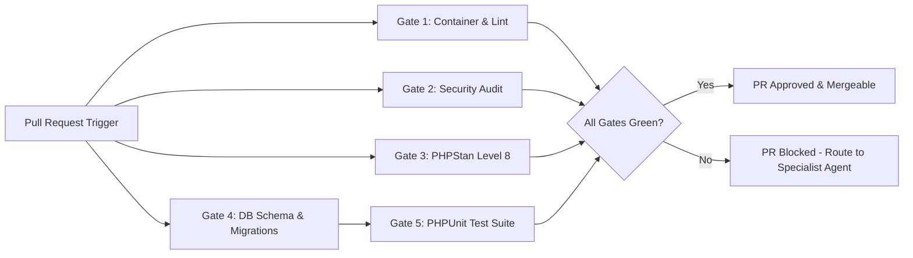

# Automated CI/CD Agent Validation Gates — GitHub Actions & GitLab CI

This guide explains how to integrate the **Symfony Engineering Agent** validation gates into automated CI/CD pipelines (GitHub Actions and GitLab CI). These automated gates prevent unverified, insecure, or substandard code from merging into production branches.

---

## 1. Overview of the 5 Mandatory Quality Gates

Every Pull Request must pass through five sequential or parallel automated gates mirroring the specialist agents' verification standards:



| Quality Gate | Responsible Specialist | Executed Commands | Failure Threshold |
|:---|:---|:---|:---|
| **Gate 1: Container & Config Lint** | `symfony-performance-specialist` | `composer validate --strict`<br>`php bin/console lint:container`<br>`php bin/console lint:yaml config` | Any invalid service injection, syntax error, or unmapped parameter. |
| **Gate 2: Security Vulnerability Audit** | `security-engineer` | `composer audit` | Any package with known, unmitigated CVEs. |
| **Gate 3: Static Analysis (Level 8+)** | `quality-engineer` | `vendor/bin/phpstan analyse --level=8` | Any type mismatch, unhandled null, or missing generic PHPDoc. |
| **Gate 4: Database Schema Integrity** | `database-engineer` | `php bin/console doctrine:schema:validate --skip-sync`<br>`doctrine:migrations:migrate`<br>`doctrine:schema:validate` | Any entity mapping mismatch or uncommitted migration. |
| **Gate 5: Automated Test Suite** | `quality-engineer` | `php bin/phpunit --testdox` | Any failing unit or functional `WebTestCase` scenario (200, 422, 403). |

---

## 2. GitHub Actions Integration

### 2.1 Workflow Template Location
We provide pre-configured, production-ready GitHub Actions templates:
- Reusable Template: [templates/ci/github/symfony-ci.yml](file:///d:/gow/symfony-engineering-agent-v2.0/symfony-engineering-agent/templates/ci/github/symfony-ci.yml)
- Active Pipeline: [.github/workflows/symfony-validation-gates.yml](file:///d:/gow/symfony-engineering-agent-v2.0/symfony-engineering-agent/.github/workflows/symfony-validation-gates.yml)

### 2.2 Installing into Your Symfony Application
From your Symfony project root:
```bash
mkdir -p .github/workflows
cp /path/to/symfony-engineering-agent/templates/ci/github/symfony-ci.yml .github/workflows/symfony-validation-gates.yml
git add .github/workflows/symfony-validation-gates.yml
git commit -m "ci: add Symfony Engineering Agent validation gates"
git push origin main
```

### 2.3 Key Features of the GitHub Actions Workflow
- **Matrix Testing:** Runs automated tests across PHP 8.2 and PHP 8.3 simultaneously.
- **Service Container:** Launches isolated PostgreSQL 16 Alpine container with active health checks (`pg_isready`).
- **Composer Caching:** Caches `vendor/` keyed by `composer.lock` hash, cutting workflow execution time from minutes to seconds.
- **Concurrency Control:** Cancels in-progress runs when new commits are pushed to the same Pull Request branch.
- **Native Annotations:** Formats PHPStan errors directly as inline code review annotations in the GitHub PR view (`--error-format=github`).

---

## 3. GitLab CI/CD Integration

### 3.1 Pipeline Template Location
- Reusable Template: [templates/ci/gitlab/.gitlab-ci.yml](file:///d:/gow/symfony-engineering-agent-v2.0/symfony-engineering-agent/templates/ci/gitlab/.gitlab-ci.yml)

### 3.2 Installing into Your GitLab Project
From your Symfony project root:
```bash
cp /path/to/symfony-engineering-agent/templates/ci/gitlab/.gitlab-ci.yml .gitlab-ci.yml
git add .gitlab-ci.yml
git commit -m "ci: configure GitLab CI agent validation pipeline"
git push origin main
```

### 3.3 Pipeline Stages & Services
- **Stages:** `validate` (linting), `analyze` (PHPStan), `security` (`composer audit`), and `test` (PHPUnit).
- **Service:** Spawns `postgres:16-alpine` service accessible via host alias `postgres`.
- **Cache Policy:** Caches `vendor/` across pipeline runs per git branch.

---

## 4. Routing CI/CD Failures to Specialist Agents

When a CI/CD validation gate fails, use the corresponding slash command in your AI chat to remediate the exact defect:

```
[CI Failure: Container Lint Error]
└── Execute: /backend Fix service injection error in src/Service/OrderProcessor.php

[CI Failure: Composer Audit CVE Detected]
└── Execute: /security Audit and upgrade vulnerable dependencies identified in composer audit

[CI Failure: PHPStan Level 8 Error]
└── Execute: /tests Resolve PHPStan type error on line 42 of src/DTO/InvoiceResponse.php

[CI Failure: Doctrine Schema Mismatch]
└── Execute: /doctrine Schema validate failed. Generate missing migration for Invoice entity

[CI Failure: PHPUnit Test Failure]
└── Execute: /debug Investigate failing WebTestCase in tests/Controller/Api/OrderControllerTest.php
```

---

## 5. Enforcing Pull Request Protection

To guarantee that no code enters the `main` branch without passing all agent validation gates:
1. In your GitHub repository, navigate to **Settings > Branches**.
2. Click **Add branch protection rule** for `main` or `master`.
3. Check **Require status checks to pass before merging**.
4. Search for and require:
   - `Lint & Container Integrity`
   - `Security Audit (OWASP / CVEs)`
   - `PHPStan Static Analysis (Level 8+)`
   - `Database Schema & PHPUnit Tests (8.2)`
   - `Database Schema & PHPUnit Tests (8.3)`
5. Check **Require branches to be up to date before merging**.
6. Save changes.
