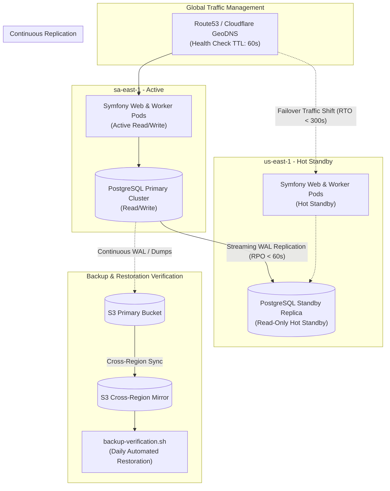

# Enterprise Disaster Recovery (DR), Multi-Region Failover & Backup Integrity

## 1. Overview
The **Symfony Engineering Agent** Disaster Recovery architecture provides enterprise resiliency for **Symfony 6.4 LTS / 7.x+** applications.

It guarantees business continuity through:
1. **Multi-Region Active/Standby Architecture:** Continuous streaming replication between primary and hot standby regions.
2. **Doctrine Primary/Replica Dynamic Routing:** Automatic read/write decoupling with sub-second failover fallback.
3. **Automated Backup Restoration Testing:** Daily cryptographic checksum and schema verification drills.
4. **Strict SLA Commitments:** Recovery Time Objective (**RTO < 5m**) and Recovery Point Objective (**RPO < 1m**).



---

## 2. Recovery Time & Point Objectives (RTO / RPO)

The DR policy (`templates/disaster-recovery/dr-policy.yaml.dist`) establishes strict recovery tiers:

| Recovery Tier | Target Services | RTO (Max Downtime) | RPO (Max Data Loss) | Replication Strategy |
|:---|:---|:---|:---|:---|
| **Tier 1 (Mission-Critical)** | Checkout, Payment, Customer API, Auth | **<= 300 seconds (5 min)** | **<= 60 seconds (1 min)** | Synchronous / Streaming WAL |
| **Tier 2 (Operational)** | Background Queues, Reports, Backoffice | **<= 3600 seconds (1 hour)** | **<= 900 seconds (15 min)** | Asynchronous Replication |

---

## 3. Doctrine Multi-Region Primary/Replica Splitting (`doctrine-multiregion.yaml.dist`)

The architecture integrates Doctrine's native `PrimaryReadReplicaConnection` wrapper:

```yaml
doctrine:
  dbal:
    default_connection: default
    connections:
      default:
        wrapper_class: 'Doctrine\DBAL\Connections\PrimaryReadReplicaConnection'
        primary:
          url: '%env(resolve:DATABASE_PRIMARY_URL)%'
        replicas:
          replica_standby:
            url: '%env(resolve:DATABASE_REPLICA_URL)%'
        options:
          connect_timeout: 3
          idle_timeout: 30
```

### Operational Rules:
1. **State Mutation:** Statements modifying database state (`INSERT`, `UPDATE`, `DELETE`) route exclusively to the `primary` endpoint.
2. **Transactions:** Any call within a transaction (`$em->wrapInTransaction()`) pins the connection strictly to the `primary`.
3. **Read Scaling:** Pure `SELECT` queries outside transactions route automatically to local or cross-region read replicas.
4. **Fault Recovery:** If the replica connection times out (`connect_timeout: 3`), the connection pool automatically falls back to `primary`.

---

## 4. Automated Backup Verification Protocol (`backup-verification.sh`)

Traditional backups that are never tested are an operational liability. The ecosystem enforces continuous automated backup restoration:

```bash
bash templates/disaster-recovery/backup-verification.sh backups/latest.sql.gz var/report.json
```

### Protocol Steps:
1. **Cryptographic Checksum Verification:** Verifies the archive SHA256 against recorded signatures.
2. **Ephemeral Restoration:** Restores the database into an isolated test environment.
3. **Doctrine Schema Validation:** Runs `php bin/console doctrine:schema:validate` to ensure entity mappings match restored tables.
4. **Data Sanity Queries:** Asserts non-zero row counts in critical tables.
5. **Auditing:** Emits a structured JSON verification report.

---

## 5. Automated Validation with `dr-validator.php`

Validate all disaster recovery configurations and budgets:

```bash
php templates/disaster-recovery/dr-validator.php --strict
```

### Policies Enforced:
- Tier 1 RTO satisfies the <= 300s budget.
- Tier 1 RPO guarantees <= 60s maximum data loss tolerance.
- Multi-region topology defines active primary and hot standby cross-region targets.
- DNS failover TTL <= 60 seconds.
- Doctrine DBAL configures `PrimaryReadReplicaConnection` wrapper.
- Backup verification script enforces cryptographic SHA256 checksums and schema integrity checks.
