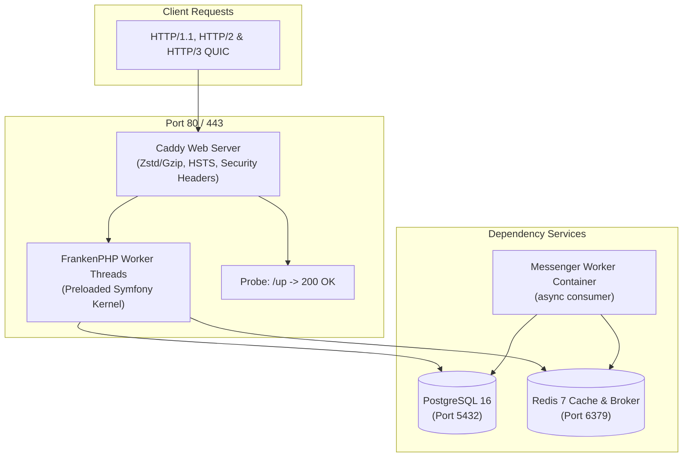

# Automated Containerization & Production Docker Architecture

## 1. Overview
The **Symfony Engineering Agent** containerization architecture provides production-ready, multi-stage Docker configurations tailored for **Symfony 6.4 LTS and 7.x+** on **PHP 8.2 and 8.3**.

It champions **FrankenPHP** (powered by Caddy and Go) as the modern, high-throughput alternative to traditional Nginx + PHP-FPM architectures, featuring native **Worker Mode**, **HTTP/3 (QUIC)**, automated TLS, and Brotli/Zstandard compression.



---

## 2. Multi-Stage Build Architecture

Both `Dockerfile.frankenphp` and `Dockerfile.php-fpm` follow an industry-standard 4-stage multi-stage build design:

| Stage Target | Base Image | Intended Purpose | Security & Cache Policies |
|:---|:---|:---|:---|
| **`base`** | `dunglas/frankenphp:1-php8.3-bookworm` | Common system libraries, PHP extensions (`pdo_pgsql`, `intl`, `opcache`, `redis`), Composer binary. | Reusable across all downstream stages. |
| **`builder`** | Extends `base` | Resolves Composer dependencies with `--no-dev --optimize-autoloader`, dumps classmaps, warms up production cache. | Discarded after build; secrets/credentials never leak into final runtime image. |
| **`dev`** | Extends `base` | Installs Xdebug, binds local workspace volumes, enables OPcache timestamp revalidation. | Runs as root for local development convenience and hot code reloading. |
| **`prod`** | Extends `base` | Copies optimized vendors and cache from `builder`, configures OPcache Preloading, enforces non-root `USER www-data`. | Read-only application root, strict healthchecks, minimum attack surface. |

---

## 3. High-Performance FrankenPHP Worker Mode

In traditional PHP-FPM, every HTTP request bootstraps the entire Symfony framework from scratch (loading hundreds of PHP files, instantiating the Dependency Injection container, and parsing routes).

With **FrankenPHP Worker Mode**, the Symfony application stays in memory between requests:
1. The Symfony kernel is initialized once at worker boot.
2. Worker threads handle requests sequentially or concurrently without re-bootstrapping.
3. Latency drops by up to **70-85%**, achieving sub-10ms response times.

### Caddyfile Configuration (`Caddyfile.dist`)
```caddyfile
{
    frankenphp {
        num_threads auto
        worker {
            file /app/public/index.php
            num auto
            env APP_RUNTIME "Runtime\\FrankenPhpSymfony\\Runtime"
        }
    }
    order mercure before respond
    order vulcain before reverse_proxy
}

:80 {
    log {
        output stdout
        format json
        level INFO
    }

    encode zstd gzip

    header {
        Strict-Transport-Security "max-age=31536000; includeSubDomains; preload"
        X-Content-Type-Options "nosniff"
        X-Frame-Options "DENY"
        Referrer-Policy "strict-origin-when-cross-origin"
        Permissions-Policy "camera=(), microphone=(), geolocation=(), payment=()"
        -Server
    }

    respond /up 200
    root * /app/public
    php_server
}
```

---

## 4. OPcache & JIT Production Optimization

In the `prod` target, OPcache is locked down to eliminate filesystem I/O:
- `opcache.validate_timestamps=0`: Prevents checking disk timestamps on every request.
- `opcache.memory_consumption=256`: Generous memory allocation preventing cache eviction.
- `opcache.preload=/app/config/preload.php`: Compiles critical classes into shared memory before any request arrives.

---

## 5. Automated Entrypoint Initialization

The container entrypoint script (`templates/docker/docker-entrypoint.sh`) handles orchestration requirements:
1. **Relational Database Polling:** Retries `php bin/console doctrine:query:sql "SELECT 1"` with exponential backoff until the database is ready.
2. **Automatic Migrations:** Executes `doctrine:migrations:migrate --no-interaction` when `AUTO_MIGRATE=true` or in production.
3. **Cache Warmup:** Asserts that the production container cache is completely pre-compiled before traffic routes to it.
4. **Signal Handling:** Propagates POSIX signals (`SIGTERM`, `SIGINT`) seamlessly using `exec "$@"`.

---

## 6. Automated Validation with `docker-validator.php`

The ecosystem provides a dedicated CLI tool to validate container manifests before pushing to registries or running in CI/CD:

```bash
php templates/docker/docker-validator.php --strict
```

### Options:
- `--dockerfile=<path>`: Path to Dockerfile (default: `templates/docker/Dockerfile.frankenphp`).
- `--compose=<path>`: Path to Docker Compose (default: `templates/docker/compose.yaml.dist`).
- `--caddyfile=<path>`: Path to Caddyfile (default: `templates/docker/Caddyfile.dist`).
- `--strict`: Fails if any warning is detected.
- `--output-json=<file>`: Exports structured audit results to a JSON file.

### Validated Policies:
- Mandatory multi-stage targets (`base`, `builder`, `dev`, `prod`).
- Unprivileged `USER www-data` directive in `prod` target.
- Automated `HEALTHCHECK` probe configuration.
- Database (`pg_isready`) and Redis (`redis-cli ping`) healthcheck dependencies in Compose.
- HTTP/3 QUIC UDP port binding (`443:443/udp`).
- HTTP security headers (`HSTS`, `nosniff`, `DENY`, `Referrer-Policy`).
