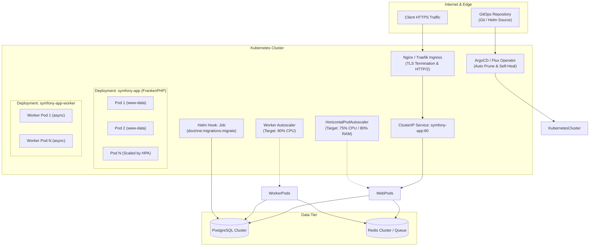

# Kubernetes Helm Charts, GitOps & Automated HPA Orchestration

## 1. Overview
The **Symfony Engineering Agent** Kubernetes architecture delivers enterprise cloud-native deployment patterns for **Symfony 6.4 LTS / 7.x+** applications.

It provides a production-grade **Helm v2 Chart**, **GitOps continuous delivery manifests** (ArgoCD and Flux CD), **Horizontal Pod Autoscaling (HPA)** for both web and worker tiers, and automated database migration lifecycle hooks.



---

## 2. Helm Chart Architecture (`templates/kubernetes/helm/symfony-app`)

### Component Breakdown:
- **`Chart.yaml`**: Official Helm v2 chart metadata with semantic versioning.
- **`values.yaml`**: Centralized configuration specifying replica counts, resource quotas, HPA parameters, security contexts, probes, and worker settings.
- **`templates/deployment-web.yaml`**: Zero-downtime rolling update deployment for the web application (`maxUnavailable: 0`, `maxSurge: 25%`).
- **`templates/deployment-worker.yaml`**: Independent deployment for asynchronous Symfony Messenger consumers (`messenger:consume async`).
- **`templates/service.yaml`**: High-availability internal `ClusterIP` service routing traffic across healthy pods.
- **`templates/ingress.yaml`**: Ingress routing with automatic TLS certificate provisioning via `cert-manager`.
- **`templates/hpa.yaml`**: Native `autoscaling/v2` metrics targeting CPU and memory utilization.
- **`templates/pdb.yaml`**: `PodDisruptionBudget` asserting `minAvailable: 1` during node draining and cluster upgrades.
- **`templates/job-migration.yaml`**: Helm hook Job executing `doctrine:migrations:migrate --no-interaction` before traffic reaches updated pods.

---

## 3. CIS Kubernetes Benchmark Hardening

The Helm chart enforces the principle of least privilege:
```yaml
podSecurityContext:
  runAsNonRoot: true
  runAsUser: 33 # www-data
  fsGroup: 33
  seccompProfile:
    type: RuntimeDefault

securityContext:
  allowPrivilegeEscalation: false
  capabilities:
    drop:
      - ALL
```

---

## 4. Horizontal Pod Autoscaler (HPA) Tuning

The HPA policy balances responsiveness and cost efficiency:
- **Minimum Replicas:** 2 pods (ensures high availability across availability zones).
- **Maximum Replicas:** 10 pods (prevents runaway compute costs).
- **CPU Threshold:** 75% average utilization.
- **Memory Threshold:** 80% average utilization.

When traffic spikes occur, Kubernetes scales the web deployment up within 15–30 seconds. In conjunction with FrankenPHP worker mode, new pods handle traffic with sub-10ms response times.

---

## 5. GitOps Delivery with ArgoCD and Flux CD

The repository provides ready-to-deploy GitOps manifests:

### ArgoCD Application (`templates/kubernetes/gitops/argocd-application.yaml.dist`)
- Automated sync policy with `prune: true` and `selfHeal: true`.
- Exponential retry backoff on deployment failures.
- Environment-specific override support (`values.yaml`, `values-prod.yaml`).

### Flux CD Kustomization (`templates/kubernetes/gitops/flux-kustomization.yaml.dist`)
- Automated polling of Git repository every 1 minute.
- Automated `HelmRelease` remediation with up to 3 automatic retries.

---

## 6. Automated Validation with `k8s-validator.php`

Before committing manifests to Git or deploying via GitOps, validate chart integrity:

```bash
php templates/kubernetes/k8s-validator.php --strict
```

### Validations Enforced:
1. Helm chart v2 metadata and semantic versioning.
2. Resource limits and requests configured on all pods.
3. Unprivileged non-root execution (`runAsNonRoot: true`).
4. Full probe coverage (`liveness`, `readiness`, `startup`).
5. Zero-downtime rolling update strategy (`maxUnavailable: 0`).
6. PodDisruptionBudget presence.
7. Database migration hook lifecycle annotations.
8. ArgoCD and Flux CD syntax validity.
