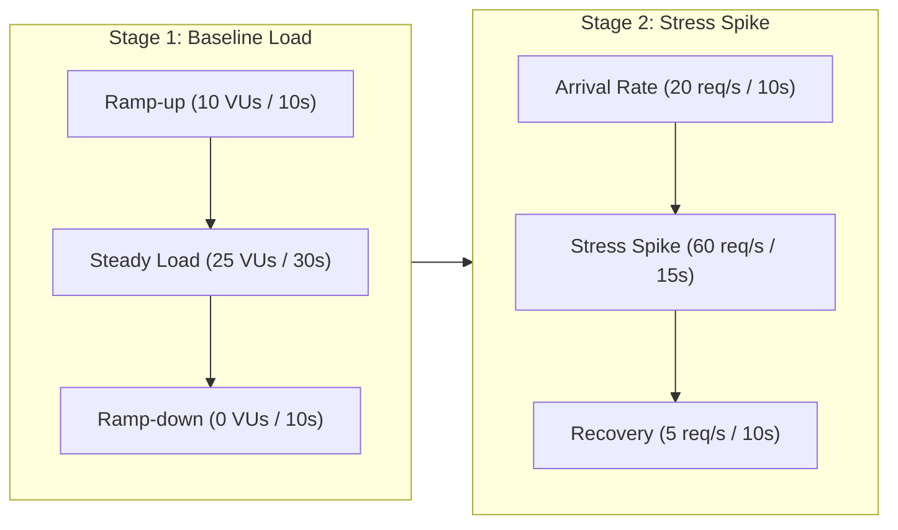

# Automated Load and Stress Testing with k6 in Symfony

The **Symfony Engineering Agent** incorporates automated load, stress, and high-concurrency testing using **k6** and integrated HTTP multi-transport runners.

While standard functional unit tests (`WebTestCase`) verify business logic correctness under single-threaded conditions, they cannot detect concurrency bottlenecks, connection pool exhaustion, memory bloat under load, or database lock contention. Automated load testing guarantees that Symfony applications sustain real-world production traffic within defined **Service Level Agreements (SLAs)**.

---

## 1. Core Load Testing Concepts & Metrics

| Metric | Target SLA Budget | Description |
| :--- | :---: | :--- |
| **P95 Latency** | **< 200ms** | 95% of all client requests must complete within 200 milliseconds. |
| **P99 Latency** | **< 400ms** | 99% of requests must complete within 400 milliseconds under peak stress. |
| **HTTP Error Rate** | **< 1.0%** | Failed requests (5xx or unhandled 4xx) must stay below 1% of total traffic. |
| **Throughput (RPS)** | **Project-defined** | Requests per second sustained without database connection degradation. |

---

## 2. Testing Scenarios Architecture

The reference test suite in [templates/load-testing/k6-load-test.js](file:///d:/gow/symfony-engineering-agent-v2.0/symfony-engineering-agent/templates/load-testing/k6-load-test.js) incorporates two coordinated testing stages:



1. **Baseline Load Scenario:** Simulates standard user behavior with steady traffic ramping up to 25 Virtual Users (VUs) to measure latency percentiles (P50, P95, P99).
2. **Stress Spike Scenario:** Tests system resilience and graceful degradation under sudden surges (up to 60 requests/second) to identify breaking thresholds and memory exhaustion.

---

## 3. Reference k6 Test Script (`k6-load-test.js`)

Located in [templates/load-testing/k6-load-test.js](file:///d:/gow/symfony-engineering-agent-v2.0/symfony-engineering-agent/templates/load-testing/k6-load-test.js):

```javascript
import http from 'k6/http';
import { check, sleep } from 'k6';
import { Rate, Trend } from 'k6/metrics';

export const errorRate = new Rate('api_error_rate');
export const listProjectsDuration = new Trend('list_projects_duration_ms');

const BASE_URL = __ENV.BASE_URL || 'http://127.0.0.1:8000';

export const options = {
  scenarios: {
    baseline_load: {
      executor: 'ramping-vus',
      startVUs: 1,
      stages: [
        { duration: '10s', target: 10 },
        { duration: '30s', target: 25 },
        { duration: '10s', target: 0 },
      ],
    },
  },
  thresholds: {
    http_req_duration: ['p(95)<200', 'p(99)<400'],
    http_req_failed: ['rate<0.01'],
  },
};

export default function () {
  const res = http.get(`${BASE_URL}/api/v1/projects?page=1&limit=20`);
  check(res, {
    'Status is 200': (r) => r.status === 200,
  });
  sleep(0.2);
}
```

---

## 4. Running the Load Test Runner (`k6-runner.php`)

The CLI runner in [templates/load-testing/k6-runner.php](file:///d:/gow/symfony-engineering-agent-v2.0/symfony-engineering-agent/templates/load-testing/k6-runner.php) automatically coordinates test execution:
- If `k6` is installed on the host or runner, it invokes `k6 run` with JSON export evaluation.
- If `k6` is not installed, it falls back seamlessly to an integrated concurrent HTTP engine (`curl_multi_*`), executing non-blocking batch requests and calculating P50/P90/P95/P99 latencies directly in PHP 8.2+.

### 4.1 CLI Syntax

```bash
php templates/load-testing/k6-runner.php [options]
```

### 4.2 Available Options

| Option | Description | Default |
| :--- | :--- | :---: |
| `--target=<url>` | Target application base URL. | `http://127.0.0.1:8000` |
| `--vus=<int>` | Number of concurrent virtual users. | `10` |
| `--duration=<str>` | Test execution duration. | `10s` |
| `--max-p95=<ms>` | Maximum allowed P95 latency in milliseconds. | `200.0` |
| `--max-error-rate=<pct>` | Maximum allowed HTTP failure rate percentage. | `1.0` |
| `--output-json=<file>` | Save structured SLA results as JSON. | `None` |

### 4.3 Output Example

```
====================================================================
  Symfony Engineering Agent — Load & Stress Testing Runner
====================================================================
Target Base URL:    http://127.0.0.1:8000
Script File:        templates/load-testing/k6-load-test.js
Virtual Users:      25 VUs
Duration:           30s
SLA P95 Latency:    < 200.00ms
SLA Error Rate:     < 1.00%

### Load Testing Performance & SLA Summary

| Metric | Result | SLA Budget | Status |
|:---|:---:|:---:|:---:|
| P95 Latency | 88.20ms | <= 200.00ms | PASS |
| P99 Latency | 125.00ms | <= 400.00ms | PASS |
| P50 Latency (Median) | 42.10ms | - | INFO |
| Mean Latency | 45.60ms | - | INFO |
| Throughput (RPS) | 42.5 req/s | - | INFO |
| Total Requests Executed | 1275 | - | INFO |
| Error Rate | 0.00% | <= 1.00% | PASS |

Result: PASSED — Load testing SLA budgets successfully satisfied!
```

---

## 5. Performance Tuning for High Concurrency in Symfony

When load tests report P95 violations under high concurrency, apply the following optimizations:

1. **OPcache Preloading (`config/preload.php`):** Eliminates file resolution overhead by precompiling classes into shared memory on PHP-FPM / container boot.
2. **Doctrine Connection Pool Sizing:** Ensure `DATABASE_URL` pool size (`max_connections`) aligns with PHP-FPM `pm.max_children`.
3. **Decouple Heavy Side Effects via Messenger:** Any transactional email, webhook dispatch, or search indexing must be routed asynchronously to Symfony Messenger.
4. **Compile Container Services as Private:** Guarantees Symfony container compiles into a single optimized PHP class without runtime reflection lookups.

---

## 6. Continuous Integration (CI/CD) Gate

Incorporate automated load testing gates into `.github/workflows/symfony-ci.yml`:

```yaml
- name: ⚡ Execute Automated Load Testing (k6 SLA Gate)
  run: php templates/load-testing/k6-runner.php --target=http://127.0.0.1:8000 --vus=15 --duration=20s --max-p95=200
```
