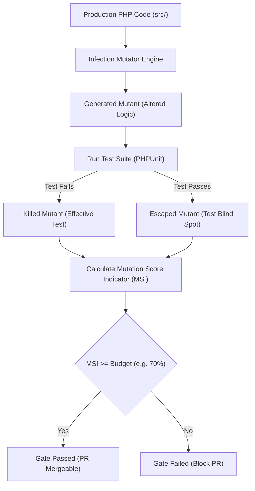

# Mutation Testing with Infection PHP & Test Efficacy Verification

The **Symfony Engineering Agent** incorporates automated mutation testing via **Infection PHP** to mathematically evaluate and verify test suite efficacy.

While standard code coverage (line or branch coverage) only measures which lines of code were executed during a test run, it provides **zero guarantee** that the tests actually assert or detect defects. Mutation testing actively introduces deliberate defects ("mutants") into your production code and checks whether your automated test suite catches and kills them.

---

## 1. What is Mutation Testing?

Mutation testing operates on a simple, powerful principle:
1. **Mutant Generation:** A mutator alters a piece of source code (e.g. changes `>` to `>=`, swaps `true` for `false`, removes a method call, or replaces a return value with `null`).
2. **Test Execution:** The test suite (`PHPUnit`) runs against the mutated code.
3. **Evaluation:**
   - **Killed Mutant:** At least one test failed as a result of the mutation. This indicates high test efficacy.
   - **Escaped Mutant:** All tests still passed despite the altered code. This reveals an assertion blind spot in your test suite!
   - **Error / Exception:** A syntax or fatal runtime error occurred.
   - **Timeout:** The mutation caused an infinite loop or stalled execution.



---

## 2. Key Metrics & Performance Budgets

The runner tracks two primary metrics:

| Metric | Formula | Description | Standard Target |
| :--- | :--- | :--- | :---: |
| **Mutation Score Indicator (MSI)** | `(Killed + TimedOut + Errors) / Total Mutants * 100` | Percentage of all generated mutants detected and killed by tests. | **≥ 70.0%** |
| **Covered Code MSI** | `(Killed + TimedOut + Errors) / Covered Mutants * 100` | Mutation score calculated only over code currently covered by tests. | **≥ 80.0%** |

---

## 3. Configuration Template: `infection.json.dist`

The ecosystem provides a standardized configuration in [templates/testing/infection.json.dist](file:///d:/gow/symfony-engineering-agent-v2.0/symfony-engineering-agent/templates/testing/infection.json.dist):

```json
{
  "$schema": "https://raw.githubusercontent.com/infection/infection/master/resources/schema.json",
  "source": {
    "directories": ["src"],
    "excludes": ["Migrations", "Kernel.php", "DataFixtures"]
  },
  "timeout": 15,
  "logs": {
    "text": "var/infection/infection.log",
    "html": "var/infection/infection.html",
    "summary": "var/infection/summary.log",
    "json": "var/infection/infection.json",
    "perMutator": "var/infection/per-mutator.md"
  },
  "tmpDir": "var/cache/infection",
  "phpUnit": {
    "configDir": "."
  },
  "mutators": {
    "@default": true,
    "@cast": true,
    "@conditional_boundary": true,
    "@conditional_negotiation": true,
    "@equality": true,
    "@function_signature": true,
    "@number": true,
    "@operator": true,
    "@regex": true,
    "@removal": true,
    "@return_value": true,
    "@sort": true,
    "@unwrap": true
  },
  "minMsi": 70.0,
  "minCoveredMsi": 80.0
}
```

---

## 4. Using the Mutation Test Runner (`mutation-runner.php`)

The CLI script [templates/testing/mutation-runner.php](file:///d:/gow/symfony-engineering-agent-v2.0/symfony-engineering-agent/templates/testing/mutation-runner.php) wraps Infection with budget evaluation and reporting:

### 4.1 CLI Syntax

```bash
php templates/testing/mutation-runner.php [options]
```

### 4.2 Available Options

| Option | Description |
| :--- | :--- |
| `-h`, `--help` | Show command usage and options. |
| `--config=<file>` | Path to custom `infection.json`. |
| `--min-msi=<float>` | Override minimum Mutation Score Indicator (e.g. `75.0`). |
| `--min-covered-msi=<float>` | Override minimum Covered Code MSI (e.g. `85.0`). |
| `--diff-only` | **Pull Request Mode:** Mutate only lines modified in current Git branch (`--git-diff-lines`). Significantly reduces CI execution time. |
| `--threads=<int\|auto>` | Number of CPU cores for parallel execution. |
| `--output-json=<file>` | Write structured report to JSON file. |

### 4.3 Output Example

```
====================================================================
  Symfony Engineering Agent — Mutation Testing Runner
====================================================================
Configuration:      templates/testing/infection.json.dist
Min MSI Budget:     70.0%
Min Covered MSI:    80.0%
Diff-Only Mode:     ENABLED (--git-diff-lines)
Threads:            auto

### Mutation Testing Summary Report

| Metric | Value | Budget | Status |
|:---|:---:|:---:|:---:|
| Mutation Score Indicator (MSI) | 78.4% | >= 70.0% | PASS |
| Covered Code MSI | 86.2% | >= 80.0% | PASS |
| Total Mutants Generated | 142 | - | INFO |
| Killed Mutants | 110 | - | PASS |
| Escaped Mutants | 28 | 0 | WARN |
| Errors / Exceptions | 0 | 0 | PASS |
| Timeouts | 4 | - | INFO |

Result: PASSED — Mutation quality gates satisfied successfully!
```

---

## 5. Analyzing and Remediating Escaped Mutants

When a mutant escapes, Infection logs the diff in `var/infection/infection.log`.

### Example 1: Boundary Mutation (`>=` replaced with `>`)

```diff
- if ($order->getTotalAmount() >= 100.0) {
+ if ($order->getTotalAmount() > 100.0) {
      $discount = 10.0;
  }
```
**Why it escaped:** The test suite tested \$99 and \$150, but never tested the exact boundary condition (\$100).  
**Remediation:** Add a boundary test case asserting that exactly \$100 unlocks the discount:
```php
public function testExactThresholdQualifiesForDiscount(): void
{
    $order = new Order(totalAmount: 100.0);
    $this->assertSame(10.0, $order->calculateDiscount());
}
```

### Example 2: Return Value Mutation (`return true` replaced with `return false`)

```diff
- public function isActive(): bool
- {
-     return 'active' === $this->status;
- }
+ public function isActive(): bool
+ {
+     return false;
+ }
```
**Why it escaped:** Tests invoked `$user->isActive()` but never asserted the returned boolean value.  
**Remediation:** Add an explicit assertion:
```php
$this->assertTrue($activeUser->isActive());
```

---

## 6. Continuous Integration (CI/CD) Gate

Incorporate mutation testing into your PR pipelines. To keep CI fast, utilize `--diff-only` on pull requests:

### GitHub Actions Integration (`.github/workflows/symfony-ci.yml`)

```yaml
- name: 🧬 Run Mutation Testing (Infection PR Diff)
  if: github.event_name == 'pull_request'
  run: php templates/testing/mutation-runner.php --diff-only --min-msi=70
```

### Full Nightly / Main Branch Gate

```yaml
- name: 🧬 Run Full Mutation Testing Suite
  if: github.ref == 'refs/heads/main'
  run: php templates/testing/mutation-runner.php --min-msi=70 --threads=auto
```
