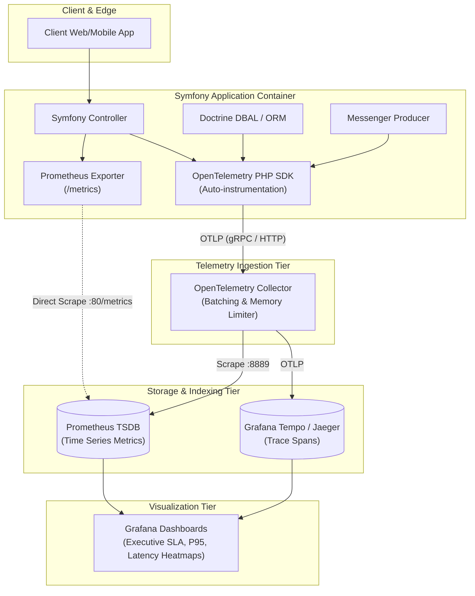

# OpenTelemetry Distributed Tracing, Prometheus Metrics & Grafana Observability

## 1. Overview
The **Symfony Engineering Agent** observability architecture provides deep production visibility into **Symfony 6.4 LTS / 7.x+** applications.

It unifies the **Three Pillars of Observability**:
1. **Distributed Tracing (OpenTelemetry):** End-to-end W3C trace context propagation across HTTP controllers, Doctrine queries, Symfony Messenger queues, and third-party APIs.
2. **Metrics Collection (Prometheus):** RED method (Rate, Errors, Duration), database latency histograms, and asynchronous worker queue depth.
3. **Visualization & Alerting (Grafana):** Production-ready executive and engineering dashboard with golden signal panels and latency percentiles.



---

## 2. OpenTelemetry Tracing Configuration (`otel.yaml.dist`)

The OpenTelemetry bundle configuration integrates native auto-instrumentation across all application boundaries:

```yaml
otel:
  service:
    name: '%env(default:symfony-app:OTEL_SERVICE_NAME)%'
    version: '%env(default:1.0.0:APP_VERSION)%'
    environment: '%env(APP_ENV)%'

  tracing:
    enabled: true
    sampler:
      type: 'parent_based'
      ratio: '%env(default:1.0:OTEL_TRACES_SAMPLER_RATIO)%'
    exporter:
      type: 'otlp'
      endpoint: '%env(default:http://otel-collector:4318/v1/traces:OTEL_EXPORTER_OTLP_ENDPOINT)%'
      protocol: 'http/protobuf'

    instrumentation:
      http:
        enabled: true
      doctrine:
        enabled: true
        capture_sql: true
      messenger:
        enabled: true
        propagate_context: true
      http_client:
        enabled: true
        propagate_context: true
```

### Context Propagation:
W3C standard headers (`traceparent`, `tracestate`) are injected into outgoing HTTP requests and Symfony Messenger envelope stamps (`AmqpStamp`, `RedisStamp`), ensuring end-to-end trace correlation across decoupled background workers.

---

## 3. Prometheus Metrics & The RED Method (`prometheus.yaml.dist`)

Metrics are structured following Google Site Reliability Engineering (SRE) Golden Signals:
- **Rate:** `sum(rate(symfony_http_requests_total[5m]))`
- **Errors:** `sum(rate(symfony_http_requests_total{status_code=~"5.."}[5m]))`
- **Duration (P95):** `histogram_quantile(0.95, sum(rate(symfony_http_request_duration_seconds_bucket[5m])) by (le))`

### Key Application Metrics:
| Metric Name | Type | Description |
|:---|:---|:---|
| `symfony_http_requests_total` | Counter | Total requests by route, method, status code. |
| `symfony_http_request_duration_seconds` | Histogram | Request latency with sub-millisecond buckets. |
| `symfony_database_queries_total` | Counter | Database queries executed via Doctrine. |
| `symfony_database_query_duration_seconds` | Histogram | SQL execution duration by operation. |
| `symfony_messenger_messages_total` | Counter | Messages dispatched, processed, or failed. |
| `symfony_messenger_queue_size` | Gauge | Instantaneous queue backlog depth. |
| `symfony_memory_peak_bytes` | Gauge | PHP peak allocated memory footprint. |
| `symfony_opcache_hit_ratio` | Gauge | Shared memory OPcache hit ratio percentage. |

---

## 4. Production Grafana Dashboard (`symfony-dashboard.json`)

The template includes an executive and engineering dashboard configured with:
1. **Executive SLA Panels:**
   - Real-time HTTP Availability Percentage (Green >= 99.9%, Yellow >= 99.0%, Red < 99.0%).
   - P95 Request Latency in milliseconds (< 150ms budget).
   - Instantaneous Total Throughput (req/s).
   - 5xx Server Error Percentage (< 0.5% SLA).
2. **Latency Heatmaps & Percentiles:**
   - Multi-line visualization tracking P50 Median, P90, P95, and P99 tail latency.
3. **Traffic Distribution:**
   - Stacked bar timeseries breaking down HTTP traffic into 2xx, 3xx, 4xx, and 5xx responses.
4. **Database & Asynchronous Worker Monitoring:**
   - P95 query latency by SQL operation (`SELECT`, `INSERT`, `UPDATE`).
   - Messenger queue backlog depth vs worker consumption throughput.

---

## 5. Automated Validation with `observability-validator.php`

Validate all telemetry assets before deploying:

```bash
php templates/observability/observability-validator.php --strict
```

### Validations Enforced:
- OpenTelemetry tracing enabled with ParentBased sampler.
- OTLP export transport configured.
- Auto-instrumentation spans configured for HTTP, Doctrine, Messenger, and HttpClient.
- Prometheus scraper endpoint and metric definitions present.
- OTel Collector receivers, safety processors (`memory_limiter`, `batch`), and pipelines.
- Grafana dashboard JSON schema validity and PromQL query correctness.
