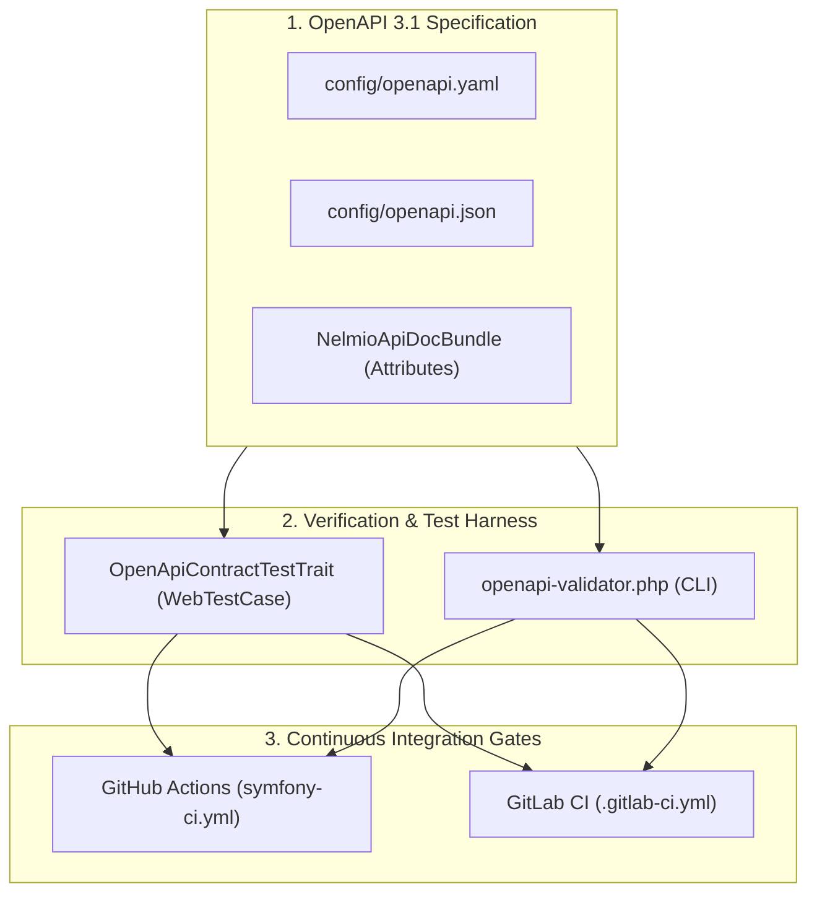

# OpenAPI / Swagger Contract Testing & Schema Regression Harness

The **Symfony Engineering Agent** incorporates automated OpenAPI 3.0 / 3.1 contract testing and schema regression verification into its core engineering and quality assurance workflows.

This manual explains how to enforce strict API contracts, eliminate breaking changes for frontend and mobile consumers, detect unintentional data leakage with `additionalProperties: false`, validate RFC 7807 Problem Details error responses, and execute automated validation gates in CI/CD.

---

## 1. The Contract Drift Problem

In rapid development cycles, backend implementations frequently drift from API documentation:
- **Missing Required Fields:** A backend refactor omits a field expected by consumers.
- **Type Alterations:** An identifier changes from an integer to a string, breaking consumer parsers.
- **Undocumented Properties:** An entity serializer inadvertently leaks sensitive internal properties (e.g. `hashedPassword`, `internalNote`) because schemas lack strict boundary assertions.
- **Inconsistent Error Formats:** One controller returns `{ "error": "msg" }`, another returns `{ "message": "msg" }`, while Symfony standards mandate RFC 7807/9457 Problem Details (`{ "type": "...", "title": "...", "status": 422, "violations": [...] }`).

The contract test harness turns the OpenAPI specification into an executable, verifiable test suite inside Symfony's standard `WebTestCase`.

---

## 2. Architecture & Components

The OpenAPI contract testing ecosystem consists of four unified components:



| Component | Path | Purpose |
| :--- | :--- | :--- |
| **Contract Test Trait** | `templates/contracts/OpenApiContractTestTrait.php` | Reusable PHPUnit trait for `WebTestCase` asserting response codes, headers, JSON body schemas, required fields, and zero undocumented properties. |
| **CLI Validator** | `templates/contracts/openapi-validator.php` | Standalone CLI script validating OpenAPI syntax, broken `$ref` pointers, RFC 7807 conformance, and Symfony route coverage. |
| **Reference Contract (YAML)** | `templates/contracts/openapi.yaml.dist` | Production-grade OpenAPI 3.1 contract following strict typing and RFC 7807 error responses. |
| **Reference Contract (JSON)** | `templates/contracts/openapi.json.dist` | Native JSON equivalent for environments without YAML parsers. |

---

## 3. Using `OpenApiContractTestTrait` in `WebTestCase`

### 3.1 Basic Functional Contract Assertion

To validate that an API endpoint satisfies the OpenAPI contract, copy `OpenApiContractTestTrait.php` into `tests/Contract/` (or use it via project namespace) and include it in your functional test:

```php
<?php

declare(strict_types=1);

namespace App\Tests\Contract;

use Symfony\Bundle\FrameworkBundle\Test\WebTestCase;

final class ProjectContractTest extends WebTestCase
{
    use OpenApiContractTestTrait;

    public function testListProjectsStrictlyMatchesOpenApiContract(): void
    {
        $client = static::createClient();

        // Execute request against Symfony kernel
        $client->request('GET', '/api/v1/projects');

        // Asserts status code (200), Content-Type (application/json),
        // and validates payload recursively against '#/components/schemas/ProjectCollection'
        $this->assertResponseMatchesOpenApi(
            client: $client,
            path: '/api/v1/projects',
            method: 'GET',
            expectedStatusCode: 200
        );
    }
}
```

### 3.2 Testing Parameterized Paths (`{id}`)

The trait automatically matches concrete URI paths against parameterized OpenAPI patterns:

```php
public function testGetSingleProjectContract(): void
{
    $client = static::createClient();

    // Concrete path with ID '1' matches pattern '/api/v1/projects/{id}'
    $client->request('GET', '/api/v1/projects/1');

    $this->assertResponseMatchesOpenApi(
        client: $client,
        path: '/api/v1/projects/1',
        method: 'GET',
        expectedStatusCode: 200
    );
}
```

### 3.3 Validating RFC 7807 / RFC 9457 Problem Details

For 4xx and 5xx error responses, use `assertProblemDetailsMatchesOpenApi()` to guarantee standardized error structures:

```php
public function testCreateProjectValidationFailureReturnsConformingProblemDetails(): void
{
    $client = static::createClient();

    // Send invalid payload (missing required 'name' field)
    $client->request(
        'POST',
        '/api/v1/projects',
        [],
        [],
        ['CONTENT_TYPE' => 'application/json'],
        json_encode(['budget' => -500], JSON_THROW_ON_ERROR)
    );

    // Asserts:
    // 1. Status code is 422 Unprocessable Entity
    // 2. Content-Type is 'application/problem+json'
    // 3. Payload has 'type', 'title', 'status', and 'violations'
    // 4. Matches OpenAPI schema definition
    $this->assertProblemDetailsMatchesOpenApi(
        client: $client,
        path: '/api/v1/projects',
        method: 'POST',
        expectedStatusCode: 422
    );
}
```

### 3.4 204 No Content Deletions

For endpoints returning `204 No Content`, the trait asserts that the HTTP response body is completely empty:

```php
public function testDeleteProjectConformsToContract(): void
{
    $client = static::createClient();
    $client->request('DELETE', '/api/v1/projects/1');

    $this->assertResponseMatchesOpenApi(
        client: $client,
        path: '/api/v1/projects/1',
        method: 'DELETE',
        expectedStatusCode: 204
    );
}
```

---

## 4. CLI Contract Validator (`openapi-validator.php`)

The CLI validator script tests the contract document itself before running tests, and can verify route coverage against Symfony's routing registry.

### 4.1 CLI Syntax

```bash
php templates/contracts/openapi-validator.php [spec-file.yaml|json] [options]
```

### 4.2 Available Options

| Option | Description |
| :--- | :--- |
| `--help`, `-h` | Display help and argument syntax. |
| `--strict` | Enforce `additionalProperties: false` on all schemas and mandate RFC 7807 on 4xx/5xx responses. |
| `--check-routes` | Inspects `bin/console debug:router` and verifies all `/api/*` routes are documented. |
| `--output-json=<file>` | Writes the validation summary and any detected errors to a structured JSON file. |

### 4.3 CLI Output Example

```
====================================================================
  Symfony Engineering Agent — OpenAPI Contract Validator
====================================================================
Spec File:    config/openapi.yaml
Strict Mode:  ENABLED
Route Check:  ENABLED

Checking route coverage against Symfony router (bin/console debug:router)...

Validation Metrics:
  - Paths Documented:      2
  - Operations Defined:    4
  - Component Schemas:     5
  - Errors Detected:       0
  - Warnings:              0

Result: PASSED (OpenAPI contract specification is valid!)
```

If broken `$ref` pointers, missing required fields, or undocumented routes are detected, the validator reports exact locations and exits with code `1`:

```
Errors Encountered:
  [ERROR] Broken $ref pointer '#/components/schemas/NonExistentSchema' found in spec->paths->/api/v1/projects->get.
  [ERROR] Path 'api/v1/projects' must start with a leading slash '/'.

Result: FAILED (Contract violations detected)
```

---

## 5. Strict Schema Rules: `additionalProperties: false`

To prevent data leakage and ensure contracts are airtight, every object schema in OpenAPI should explicitly specify:

```yaml
components:
  schemas:
    ProjectResponse:
      type: object
      additionalProperties: false
      required:
        - id
        - name
        - status
        - createdAt
      properties:
        id:
          type: integer
        name:
          type: string
        status:
          type: string
          enum: [draft, active, archived]
        createdAt:
          type: string
          format: date-time
```

When `additionalProperties: false` is configured, if an entity serializes an unlisted attribute (e.g. `internal_crm_id` or `password_hash`), `OpenApiContractTestTrait` immediately fails the test:

```
OpenAPI Contract Breach: Undocumented properties [internal_crm_id] detected at [GET /api/v1/projects] -> body->data[0] with additionalProperties=false.
```

---

## 6. Continuous Integration (CI/CD) Quality Gate

Incorporate the OpenAPI Contract Validator and PHPUnit contract tests into your CI/CD pipelines.

### 6.1 GitHub Actions Workflow Gate

Add this step to your `.github/workflows/symfony-ci.yml`:

```yaml
- name: 📜 Validate OpenAPI Specification
  run: php templates/contracts/openapi-validator.php config/openapi.yaml --strict --check-routes

- name: 🧪 Execute OpenAPI Contract Regression Tests
  run: vendor/bin/phpunit --testsuite=contract --colors=always
```

### 6.2 GitLab CI Stage

Add to `.gitlab-ci.yml`:

```yaml
openapi_contract_gate:
  stage: test
  script:
    - php templates/contracts/openapi-validator.php config/openapi.yaml --strict
    - vendor/bin/phpunit --filter=Contract
  rules:
    - if: $CI_PIPELINE_SOURCE == 'merge_request_event'
```

---

## 7. Generating OpenAPI Specifications with NelmioApiDocBundle

For code-first workflows, configure `NelmioApiDocBundle` and dump the specification directly for validation:

1. Annotate Controller DTOs with PHP 8 Attributes:
```php
use OpenApi\Attributes as OA;

#[OA\Tag(name: 'Projects')]
#[OA\Response(
    response: 200,
    description: 'Paginated project list',
    content: new OA\JsonContent(ref: '#/components/schemas/ProjectCollection')
)]
#[Route('/api/v1/projects', methods: ['GET'])]
public function list(): JsonResponse
{
    // ...
}
```

2. Dump and validate in CI before running contract tests:
```bash
php bin/console nelmio:apidoc:dump --format=json > config/openapi.json
php templates/contracts/openapi-validator.php config/openapi.json --strict
```
