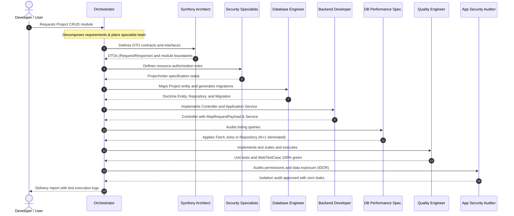
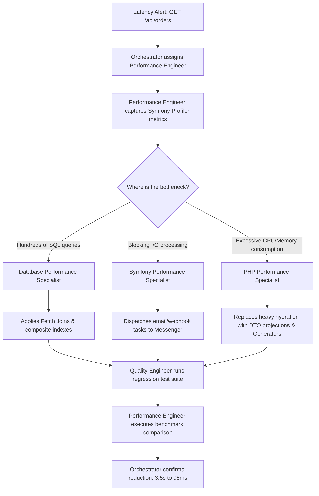
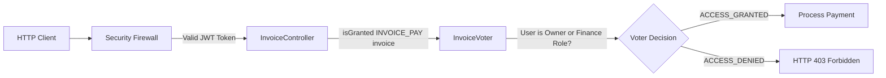

# Detailed Orchestration Scenarios — Symfony Engineering Agent

This document illustrates the end-to-end multi-agent orchestration flows for the core engineering scenarios in modern PHP 8.2+ and Symfony 6.4/7+ applications.

---

## Scenario 1: Complete Entity CRUD with Relationships and Security

### Objective
Implement an end-to-end `Project` management module where each project belongs to a `Client` and includes multiple `User` members. Features must include create, read, update, and delete endpoints, strict input validation, granular Voter authorization, and zero N+1 queries.

### 1. Sequence Diagram



### 2. Step-by-Step Execution Plan

| Step | Responsible Agent | Active Skills | Executed Action | Tangible Deliverable |
|:---:|:---|:---|:---|:---|
| **1** | `orchestrator` | `project-discovery` | Scopes requirements, confirms PostgreSQL database, generates implementation plan. | Structured execution plan. |
| **2** | `symfony-architect` | `architecture-design`, `api-design` | Models `CreateProjectRequest`, `UpdateProjectRequest`, `ProjectResponse`, and `ProjectManagementInterface`. | Immutable DTOs in `src/DTO/`. |
| **3** | `symfony-security-specialist` | `symfony-security` | Models `ProjectVoter` supporting `PROJECT_VIEW`, `PROJECT_EDIT`, `PROJECT_DELETE`. | `src/Security/Voter/ProjectVoter.php`. |
| **4** | `database-engineer` | `doctrine-persistence` | Maps `Project` entity, ManyToOne to `Client`, ManyToMany to `User`, generates migration. | Entity, Repository, and migration file. |
| **5** | `symfony-backend-developer` | `symfony-application` | Implements `ProjectController` with `#[MapRequestPayload]` and `ProjectService`. | Skinny controller and application service. |
| **6** | `database-performance-specialist`| `database-performance` | Inspects `ProjectRepository::findAllWithDetails()` and adds `leftJoin('p.client', 'c')->addSelect('c')`. | N+1 free query method. |
| **7** | `quality-engineer` | `testing-quality` | Implements `ProjectControllerTest` extending `WebTestCase` (success 201, invalid 422, forbidden 403). | Executed automated test suite. |
| **8** | `application-security-auditor` | `security-audit` | Executes cross-tenant unauthorized access test (User from Client A requesting Project from Client B). | Tenant isolation verification proof. |
| **9** | `orchestrator` | `technical-documentation` | Compiles test execution logs and presents final deliverable to developer. | Final delivery report. |

### 3. Completion Criteria
- `php bin/console lint:container` passes cleanly.
- `php bin/console doctrine:schema:validate` confirms mapping and schema are in sync.
- `php bin/phpunit tests/Controller/Api/ProjectControllerTest.php` 100% green.
- `vendor/bin/phpstan analyse src` level 8 clean.

---

## Scenario 2: Investigating and Resolving Critical API Latency

### Objective
Diagnose the root cause of an endpoint (`GET /api/orders`) taking over 3.5 seconds to respond under moderate load, apply surgical optimizations, and prove latency drops below 120ms.

### 1. Optimization Flowchart



### 2. Execution Steps
1. **Orchestrator:** Scopes the performance incident on route `/api/orders` and engages the High-Performance Nucleus.
2. **Performance Engineer (`performance-profiling`):**
   - Inspects execution traces: reveals 251 SQL queries executed for 50 orders (classic N+1 query problem) and 48MB peak memory.
3. **Database Performance Specialist (`database-performance`):**
   - Refactors query in `OrderRepository`:
     ```php
     // Before: 1 query for orders + 50 for customers + 200 for items
     // After: 1 single query with explicit fetch joins
     return $this->createQueryBuilder('o')
         ->leftJoin('o.customer', 'c')->addSelect('c')
         ->leftJoin('o.items', 'i')->addSelect('i')
         ->where('o.company = :company')
         ->setParameter('company', $company)
         ->setMaxResults(50)
         ->getQuery()
         ->getResult();
     ```
   - Creates migration adding composite indexes on `company_id` and `created_at`.
4. **Quality Engineer (`testing-quality`):**
   - Executes regression tests ensuring response payloads remain identical.
5. **Performance Engineer (`performance-profiling`):**
   - Re-runs benchmark: query count drops from 251 to 1; execution time drops from 3,520ms to 88ms; memory drops to 11MB.
6. **Orchestrator:** Issues "Before vs After" comparative benchmark report.

---

## Scenario 3: Implementing Secure Authentication and Granular Access (Voters)

### Objective
Implement stateless JWT authentication for API endpoints and resource-level access control via Symfony Voters, defending the system against IDOR and brute-force attacks.

### 1. Authorization Flow



### 2. Execution Steps
1. **Orchestrator:** Engages `symfony-security-specialist` and `php-security-specialist`.
2. **Symfony Security Specialist (`symfony-security`):**
   - Configures stateless firewall in `config/packages/security.yaml` with JWT authenticator.
   - Configures rate limiter on login endpoint (maximum 5 attempts per minute per IP).
   - Implements `InvoiceVoter`:
     ```php
     protected function voteOnAttribute(string $attribute, mixed $subject, TokenInterface $token): bool
     {
         $user = $token->getUser();
         if (!$user instanceof UserInterface) {
             return false;
         }

         return match ($attribute) {
             self::PAY => $subject->getOwner() === $user || in_array('ROLE_FINANCE', $user->getRoles(), true),
             default => false,
         };
     }
     ```
3. **Application Security Auditor (`security-audit`):**
   - Writes automated functional test attempting to pay an invoice using another user's valid token.
   - Confirms HTTP 403 Forbidden with RFC 7807 Problem Details.
4. **Quality Engineer (`testing-quality`):**
   - Runs full security test suite.

---

## Scenario 4: Safe Legacy Payment Module Refactoring

### Objective
Modernize a legacy 900-line payment processing class containing nested conditionals, lack of strict types, and direct database calls into a clean architecture with Services, DTOs, and the Strategy pattern without breaking production billing.

### 1. Execution Steps
1. **Orchestrator:** Assigns `project-analyst` to map dependencies and `refactoring-specialist` to execute.
2. **Project Analyst (`project-discovery`):**
   - Maps all consumers of `PaymentProcessor` and identifies only 20% test coverage.
3. **Quality Engineer (`testing-quality`):**
   - **Mandatory Safety Net:** Authors characterization tests covering all payment gateways (Credit Card, Wire, Pix) prior to modifying production code.
4. **Refactoring Specialist (`safe-refactoring`):**
   - Adds `declare(strict_types=1);`.
   - Extracts typed DTOs (`PaymentRequest`, `PaymentResult`).
   - Implements Strategy pattern with `PaymentGatewayInterface` and decoupled implementations (`StripeGateway`, `WireGateway`).
   - Shrinks main class from 900 lines to a 60-line orchestrator.
5. **Code Reviewer (`code-review`):**
   - Inspects `git diff` to ensure no interest or discount calculation logic was accidentally altered.
6. **Quality Engineer:**
   - Runs test suite; all characterization tests pass with zero regression.
