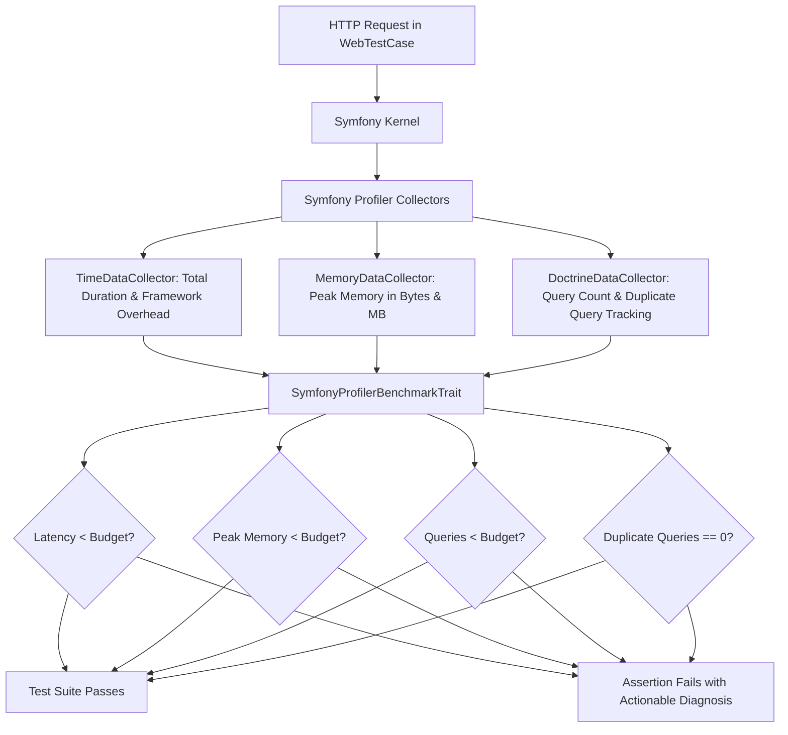

# Automated Profiling & Benchmarks Guide — Symfony Profiler Integration

This guide details the **Automated Latency, Memory, and Query Profiling** suite introduced in **v2.4** of the Symfony Engineering Agent. It enables engineering teams to mathematically enforce latency budgets, memory limits, and zero N+1 queries directly within automated tests (`WebTestCase`) and CI/CD pipelines.

---

## 1. Overview & Architecture

Conventional performance testing often happens late in production or relies on unverified manual profiling. The Symfony Engineering Agent introduces **Automated Telemetry Assertions**, integrating directly with the **Symfony Web Profiler** data collectors:



### Supported Performance Metrics
| Metric | Profiler Collector | Description | Default Budget |
|:---|:---|:---|:---|
| **Total Duration** | `TimeDataCollector` | End-to-end request latency in milliseconds (`ms`). | `< 150.0ms` (P95) |
| **Peak Memory** | `MemoryDataCollector` | Peak memory consumed during request processing (`MB`). | `< 24.0MB` |
| **Query Count** | `DoctrineDataCollector` | Total number of SQL statements executed. | `< 5 queries` |
| **Duplicate Queries** | `DoctrineDataCollector` | Identical SQL patterns executed multiple times (**N+1 query trap**). | `0 duplicates` |

---

## 2. Using `SymfonyProfilerBenchmarkTrait` in Functional Tests

The trait [templates/benchmarks/SymfonyProfilerBenchmarkTrait.php](file:///d:/gow/symfony-engineering-agent-v2.0/symfony-engineering-agent/templates/benchmarks/SymfonyProfilerBenchmarkTrait.php) allows any PHPUnit `WebTestCase` to profile and assert metrics in real-time.

### 2.1 Installing the Trait
Copy the trait to your test directory:
```bash
mkdir -p tests/Benchmark
cp templates/benchmarks/SymfonyProfilerBenchmarkTrait.php tests/Benchmark/
```

### 2.2 Writing Automated Profiling Assertions
```php
<?php

declare(strict_types=1);

namespace App\Tests\Controller\Api;

use App\Tests\Benchmark\SymfonyProfilerBenchmarkTrait;
use Symfony\Bundle\FrameworkBundle\Test\WebTestCase;
use Symfony\Component\HttpFoundation\Response;

final class ProjectApiBenchmarkTest extends WebTestCase
{
    use SymfonyProfilerBenchmarkTrait;

    public function testProjectListingMeetsStrictPerformanceBudgets(): void
    {
        $client = static::createClient();

        // 1. Enable Symfony Profiler for this request
        $this->enableSymfonyProfiler($client);

        // 2. Dispatch HTTP request
        $client->request('GET', '/api/v1/projects');

        // 3. Functional assertions
        $this->assertResponseStatusCodeSame(Response::HTTP_OK);
        $this->assertResponseHeaderSame('Content-Type', 'application/json');

        // 4. Automated Performance Profiling Assertions
        // Enforce maximum latency budget (< 120ms)
        $this->assertDurationLessThan($client, 120.0);

        // Enforce maximum memory budget (< 20MB)
        $this->assertPeakMemoryLessThan($client, 20.0);

        // Enforce database query count budget (< 4 total queries)
        $this->assertDatabaseQueryCountLessThan($client, 4);

        // Mathematically guarantee ZERO N+1 queries
        $this->assertZeroDuplicateQueries($client);
    }
}
```

---

## 3. Standalone Benchmark Runner (`benchmark-runner.php`)

For load testing and P50/P95 latency analysis against running environments, use the standalone runner [templates/benchmarks/benchmark-runner.php](file:///d:/gow/symfony-engineering-agent-v2.0/symfony-engineering-agent/templates/benchmarks/benchmark-runner.php).

### 3.1 Configuration (`benchmark.json`)
Copy the template configuration:
```bash
cp templates/benchmarks/benchmark.json.dist benchmark.json
```

Example configuration structure:
```json
{
  "base_url": "http://127.0.0.1:8000",
  "options": {
    "warmup_runs": 3,
    "measured_runs": 20
  },
  "targets": [
    {
      "name": "List Projects Endpoint",
      "method": "GET",
      "path": "/api/v1/projects",
      "headers": {
        "Accept": "application/json"
      },
      "budgets": {
        "max_duration_ms": 150.0,
        "max_memory_mb": 24.0,
        "max_queries": 4
      }
    }
  ]
}
```

### 3.2 Executing the Runner
```bash
php templates/benchmarks/benchmark-runner.php benchmark.json
```

### 3.3 Sample Output Report
```text
====================================================================
  Symfony Engineering Agent — Profiler Benchmark Runner
====================================================================
Base URL:       http://127.0.0.1:8000
Warmup Runs:    3
Measured Runs:  20
Targets:        1 endpoints

Benchmarking: [GET] /api/v1/projects (List Projects Endpoint)...

### Benchmark Summary Report

| Endpoint | Method | P50 Latency | P95 Latency | Mean Latency | Memory (MB) | Queries | Status |
|:---|:---:|:---:|:---:|:---:|:---:|:---:|:---:|
| /api/v1/projects | GET | 64.20ms | 88.50ms | 68.10ms | 14.20MB | 2 | PASS |

All performance budgets passed successfully!
```

---

## 4. Integrating Benchmarks into CI/CD

To prevent performance regressions from entering production, integrate the benchmark assertions into your CI/CD pipeline:

1. In GitHub Actions, ensure `APP_ENV: test` and profiler collection is enabled in `config/packages/test/web_profiler.yaml`:
   ```yaml
   # config/packages/test/web_profiler.yaml
   framework:
       profiler:
           collect: true
   ```
2. When `php bin/phpunit` runs, any test using `SymfonyProfilerBenchmarkTrait` will automatically fail the PR if:
   - Latency regresses beyond budget.
   - Memory consumption spikes unexpectedly.
   - An unoptimized query introduces duplicate queries (N+1).

---

## 5. Remediation Playbook with Specialist Agents

When an automated benchmark gate fails, invoke the corresponding specialist agent:

| Benchmark Failure Message | Root Cause | Remediating Command |
|:---|:---|:---|
| `N+1 Query Trap Detected: found X duplicate queries` | Missing Fetch Joins on Doctrine relationship. | `/performance Eliminate duplicate queries in <Repository> using leftJoin()->addSelect().` |
| `Response latency budget exceeded: actual was Xms` | Unindexed database filters or slow I/O. | `/performance Analyze query execution plan (EXPLAIN) and add composite index.` |
| `Memory consumption budget exceeded: actual was XMB` | Large collection hydration into memory. | `/performance Refactor to partial DTO projection and implement PHP Generators (yield).` |
| `Database query budget exceeded: actual was X queries` | Multiple queries executed inside loops. | `/backend Batch query executions using WHERE IN (:ids).` |
