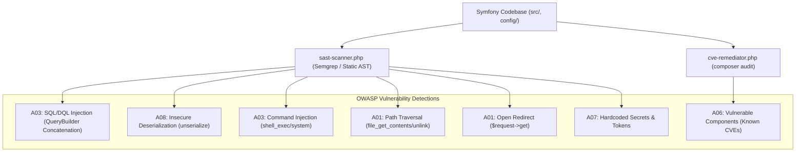

# Static Application Security Testing (SAST) & Automated CVE Remediation

The **Symfony Engineering Agent** enforces automated **Static Application Security Testing (SAST)** with **Semgrep** and automated **OWASP Dependency CVE Remediation** workflows.

Security cannot be treated as an afterthought or audited only before major releases. Automated SAST scans and dependency vulnerability checks run continuously to detect injection flaws, broken access control (IDOR), hardcoded secrets, and supply chain vulnerabilities directly within pull requests and developer workflows.

---

## 1. SAST Architecture & OWASP Top 10 Coverage

The Semgrep ruleset in [templates/security/semgrep.yaml.dist](file:///d:/gow/symfony-engineering-agent-v2.0/symfony-engineering-agent/templates/security/semgrep.yaml.dist) targets common PHP and Symfony security antipatterns:



---

## 2. Using the SAST Security Scanner (`sast-scanner.php`)

The CLI script in [templates/security/sast-scanner.php](file:///d:/gow/symfony-engineering-agent-v2.0/symfony-engineering-agent/templates/security/sast-scanner.php) automatically coordinates static security analysis:
- If `semgrep` is installed, it runs Semgrep using `templates/security/semgrep.yaml.dist` with JSON export.
- If `semgrep` is not installed, it falls back to an integrated static AST/regex security engine that inspects PHP files for SQLi, RCE, hardcoded secrets, and unsafe file operations.

### 2.1 CLI Syntax

```bash
php templates/security/sast-scanner.php [options]
```

### 2.2 Available Options

| Option | Description | Default |
| :--- | :--- | :---: |
| `--config=<file>` | Path to custom Semgrep ruleset. | `templates/security/semgrep.yaml.dist` |
| `--path=<dir>` | Target source directory to scan. | `src/` |
| `--severity=<level>` | Minimum severity to report (`error`, `warning`, `info`). | `error` |
| `--strict` | Enforce zero tolerance on warnings. | `Disabled` |
| `--output-json=<file>` | Save structured vulnerability report to JSON. | `None` |

### 2.3 Output Example: Clean Codebase

```
====================================================================
  Symfony Engineering Agent — SAST Security Scanner
====================================================================
Configuration:      templates/security/semgrep.yaml.dist
Target Directory:   src
Min Severity:       ERROR
Strict Mode:        DISABLED

SAST Scan Metrics:
  - Total Findings:        0
  - High/Critical Errors:  0
  - Warnings:              0

Result: PASSED — Zero security vulnerabilities detected!
```

### 2.4 Output Example: Vulnerability Detected

When an unparameterized variable is concatenated into a QueryBuilder statement:

```
### Detected Security Vulnerabilities:

| Severity | Rule ID | File | Line | Advisory Message |
|:---:|:---|:---|:---:|:---|
| ERROR | `symfony-doctrine-sqli-concatenation` | `src/Repository/ProjectRepository.php` | 42 | Potential SQL/DQL injection via string concatenation in QueryBuilder. Use bound parameters. |

Result: FAILED — Static security analysis detected vulnerabilities violating OWASP standards!
```

---

## 3. Automated Dependency CVE Remediation (`cve-remediator.php`)

The script in [templates/security/cve-remediator.php](file:///d:/gow/symfony-engineering-agent-v2.0/symfony-engineering-agent/templates/security/cve-remediator.php) parses `composer audit --format=json`, extracts affected packages, and generates targeted, atomic remediation commands.

### 3.1 CLI Syntax

```bash
php templates/security/cve-remediator.php [options]
```

### 3.2 Output Example: Vulnerabilities Detected

```
====================================================================
  Symfony Engineering Agent — Dependency CVE Auditor & Remediator
====================================================================

Audit Summary:
  - Total Known CVEs Detected: 1

### Detected Dependency Vulnerabilities:

| Package | Advisory / CVE | Title | Affected Versions |
|:---|:---:|:---|:---:|
| `guzzlehttp/psr7` | [GHSA-q7w8-8w5r-jmpx](https://github.com/advisories/GHSA-q7w8-8w5r-jmpx) | Improper Header Parsing in Guzzle PSR-7 | `<1.9.1` |

### Automated Remediation Instructions:

To update affected dependencies to patched versions, execute:

```bash
composer update guzzlehttp/psr7 --with-dependencies
```

After updating, verify container integrity and run test suite:
```bash
php bin/console lint:container
php bin/phpunit
```
```

---

## 4. Remediation Workflow (`workflows/cve-remediation.md`)

When dependencies contain vulnerabilities, follow the 5-phase protocol documented in [workflows/cve-remediation.md](file:///d:/gow/symfony-engineering-agent-v2.0/symfony-engineering-agent/workflows/cve-remediation.md):

1. **Detection & Triage:** Identify package and CVSS severity using `cve-remediator.php`.
2. **Blast Radius Analysis:** Trace imports via `composer why vendor/package-name`.
3. **Atomic Update:** Execute `composer update vendor/package --with-dependencies` (never run blind global updates).
4. **Automated Verification:**
   - Container lint: `php bin/console lint:container`
   - Doctrine sync: `php bin/console doctrine:schema:validate`
   - Static analysis: `vendor/bin/phpstan analyse -l 8`
   - Test suite: `php bin/phpunit`
5. **PR Signoff:** Deliver clean before-and-after audit logs.

---

## 5. Continuous Integration (CI/CD) Gate

Add SAST and CVE checks to `.github/workflows/symfony-ci.yml`:

```yaml
- name: 🛡️ Run Semgrep SAST Security Scanner
  run: php templates/security/sast-scanner.php --strict

- name: 🔒 Audit Dependencies for Known CVEs
  run: php templates/security/cve-remediator.php
```
