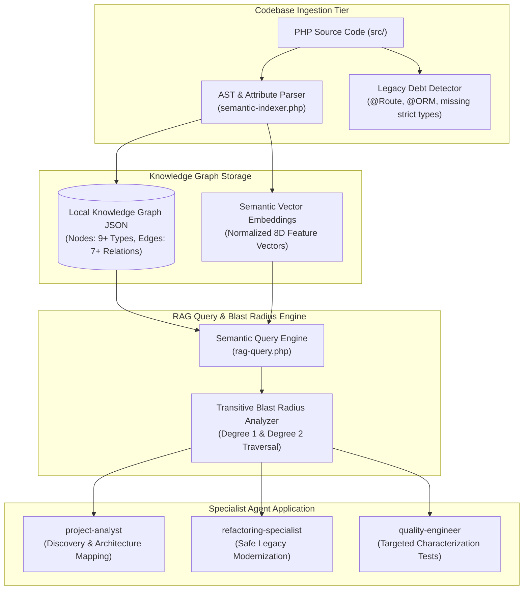

# Semantic Vector Memory & Local Knowledge Graph RAG for Symfony

## 1. Overview (Version 3.1)
**Version 3.1** introduces **Local Knowledge Graph RAG (Retrieval-Augmented Generation)** and **Semantic Vector Memory** to the Symfony Engineering Agent.

When working on enterprise Symfony codebases with thousands of files and legacy monolith architectures, LLMs face context window constraints and hallucination risks regarding complex dependency relationships. Version 3.1 solves this through:
1. **Local AST Codebase Indexing:** Extracts deep component metadata (Entities, Controllers, Services, Repositories, Voters, Messengers).
2. **Bidirectional Knowledge Graph:** Maps dependencies (`INJECTS`, `ROUTES_TO`, `QUERIES`, `PROTECTS`, `DISPATCHES`, `HANDLES`).
3. **Transitive Blast Radius Analysis:** Calculates Degree 1 (direct) and Degree 2 (transitive) ripple effects before modifying any class.
4. **Zero Cloud Leaks:** All indexing, AST parsing, graph traversal, and vector similarities run **100% locally** on PHP without third-party API dependencies.



---

## 2. Knowledge Graph Schema Specification (`knowledge-graph.json.dist`)

The local knowledge graph establishes a rich ontology across Symfony application layers:

### Node Types:
| Node Type | Key Attributes | Traversal Properties |
|:---|:---|:---|
| **`Entity`** | Table name, properties, mapping attributes (`ORM\Entity`). | Relationships (`OneToMany`, `ManyToOne`, `ManyToMany`). |
| **`Controller`** | Route paths, HTTP methods, firewall rules. | Outgoing `INJECTS`, `PROTECTED_BY`. |
| **`Service`** | Contracts/Interfaces, injected dependencies. | Outgoing `INJECTS`, `DISPATCHES`. |
| **`Repository`** | Target entity, custom query methods. | Outgoing `QUERIES`. |
| **`Voter`** | Supported security attributes, supported subjects. | Outgoing `PROTECTS`. |
| **`Message`** | Transport name (`async`), payload properties. | Linked to `MessageHandler`. |
| **`MessageHandler`** | Target handled message FQCN. | Outgoing `HANDLES`. |

### Edge Relationships:
- `ROUTES_TO`: Maps HTTP routes directly to controller actions.
- `INJECTS`: Dependency Injection dependency between classes.
- `QUERIES`: Database interaction between Repository and Entity.
- `PROTECTS` / `PROTECTED_BY`: Authorization voter link.
- `DISPATCHES` / `HANDLES`: Asynchronous message pipeline link.
- `RELATES_TO`: Relational database foreign keys and associations.

---

## 3. Transitive Blast Radius Analysis

Before refactoring legacy code, the agent calculates the exact impact perimeter:

```bash
php templates/rag/rag-query.php --query="order" --blast-radius="App\Entity\Order" --strict
```

### Example Blast Radius Output:
```text
Blast Radius for 'App\Entity\Order':
  Direct Impact (Degree 1):
    -> DEPENDENT (PROTECTS): App\Security\Voter\OrderVoter
    -> DEPENDENT (QUERIES): App\Repository\OrderRepository
    -> DEPENDS_ON (RELATES_TO): App\Entity\User
    -> DEPENDS_ON (RELATES_TO): App\Entity\OrderItem
  Transitive Ripple Impact (Degree 2):
    * App\Controller\OrderController -> App\Security\Voter\OrderVoter
    * App\Service\OrderCheckoutService -> App\Repository\OrderRepository
```

This guarantees that before modifying `App\Entity\Order`, the agent automatically verifies the Voter, the Repository queries, the Controller endpoints, and the Checkout service!

---

## 4. Semantic Codebase Indexer (`semantic-indexer.php`)

Scan and rebuild the knowledge graph on demand:

```bash
php templates/rag/semantic-indexer.php --source=src --strict
```

### Features:
- Detects missing `declare(strict_types=1);` in all PHP files.
- Identifies deprecated annotations (e.g., `@Route`, `@ORM\Column`) and reports modernization opportunities.
- Generates reproducible local embeddings for semantic component matching.

---

## 5. RAG Query CLI Engine (`rag-query.php`)

Perform semantic natural language lookups directly from the CLI:

```bash
php templates/rag/rag-query.php --query="authentication and user roles" --strict
```

### Options:
- `--query=<text>`: Semantic query string.
- `--graph=<path>`: Custom knowledge graph JSON.
- `--blast-radius=<class>`: Explicit FQCN to analyze.
- `--strict`: Fails if any warning is detected.
- `--output-json=<file>`: Exports structured query results and blast radius data.
