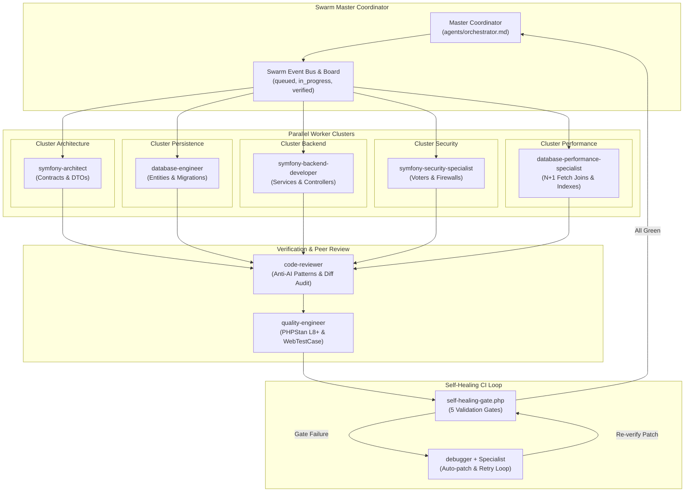

# Autonomous Multi-Agent Swarm Orchestration & Self-Healing CI Gates

## 1. Overview (Major Version 3.0 Milestone)
**Version 3.0** marks the transition of the **Symfony Engineering Agent** from sequential specialist delegation to **Autonomous Multi-Agent Swarm Orchestration**.

In high-complexity Symfony enterprise applications, features span architectural layers, security perimeters, database schemas, and performance budgets simultaneously. Version 3.0 introduces:
1. **Dynamic Task Sharding:** Automatic decomposition of complex epics into an acyclic task dependency graph (DAG).
2. **Parallel Swarm Dispatch:** Concurrent agent execution using isolated Git worktrees (`share` and `branch` modes).
3. **Autonomous Self-Healing CI Gates:** Automatic detection, root-cause triage, atomic patching, and re-verification of failing quality gates without human intervention.
4. **Peer Review Synthesis:** Mandatory cross-agent auditing (`code-reviewer`, `security-engineer`, `application-security-auditor`) before final branch consolidation.



---

## 2. Swarm Topology Specification (`swarm-topology.yaml.dist`)

The swarm topology organizes 20 specialized engineering agents into 5 functional clusters:
- **Architecture Cluster:** `symfony-architect` (Lead), `project-analyst`, `project-bootstrapper`.
- **Backend & Persistence Cluster:** `symfony-backend-developer` (Lead), `database-engineer`, `integration-specialist`.
- **Quality Cluster:** `quality-engineer` (Lead), `code-reviewer`, `debugger`, `refactoring-specialist`, `technical-writer`.
- **Security Nucleus Cluster:** `security-engineer` (Lead), `symfony-security-specialist`, `php-security-specialist`, `application-security-auditor`.
- **Performance Nucleus Cluster:** `performance-engineer` (Lead), `symfony-performance-specialist`, `database-performance-specialist`, `php-performance-specialist`.

### Workspace Isolation Modes:
- **`inherit`**: Read-only access to existing project files (used by auditors, reviewers, analysts).
- **`share`**: Shared copy of the repository for agents establishing contracts, interfaces, and test harnesses.
- **`branch`**: Isolated Git worktree clone preventing file collision during concurrent controller, entity, or migration implementation.

---

## 3. Dynamic Task Sharding Strategies

The swarm coordinator dynamically shards tasks using three distinct strategies:
1. **Domain-Driven Sharding:** Splits epics across bounded domain contexts (e.g., Billing, Customer Management, Inventory).
2. **Layer-Driven Sharding:** Simultaneously implements database entities, domain services, REST controllers, and HTTP functional tests.
3. **Verification-Driven Sharding:** Fanning out security vulnerability scans, mutation testing, architectural boundary checks, and load tests concurrently.

---

## 4. Autonomous Self-Healing CI Loop (`self-healing-gate.php`)

When a pull request or implementation fails a quality gate, human intervention is traditionally required to debug and fix it. In **v3.0**, the **Self-Healing CI Gate Harness** automates remediation:

```bash
php templates/swarm/self-healing-gate.php --strict --max-retries=3
```

### Self-Healing Failure Mappings:
| Failure Signature | Responsible Remediation Agent | Action Taken |
|:---|:---|:---|
| `lint:container` failure | `symfony-backend-developer` | Resolves untyped service injections or missing interface aliases in `config/services.yaml`. |
| PHPStan Level 8+ error | `quality-engineer` | Adds missing generic collection PHPDocs or corrects strict type hints. |
| PHPUnit test failure | `debugger` | Reproduces failure in isolated test, locates regression, and applies atomic patch. |
| Doctrine schema mismatch | `database-engineer` | Generates reversible migration via `doctrine:migrations:diff`. |
| Security vulnerability / IDOR | `symfony-security-specialist` | Injects authorization Voter check (`denyAccessUnlessGranted`). |
| N+1 query performance regression | `database-performance-specialist` | Adds explicit `addSelect` Fetch Join to repository QueryBuilder. |

---

## 5. Swarm CLI Runner (`swarm-runner.php`)

Execute full swarm task sharding and verification from the command line:

```bash
php templates/swarm/swarm-runner.php --task="Implement Customer Onboarding Module" --concurrency=4 --self-heal --strict
```

### Options:
- `--topology=<path>`: Custom swarm topology YAML file.
- `--task=<string>`: High-level epic description.
- `--concurrency=<int>`: Maximum parallel worker threads.
- `--self-heal`: Enables the autonomous self-healing remediation loop.
- `--strict`: Fails if any warning is detected across any gate.
- `--output-json=<file>`: Exports complete task graph and agent trace history.
