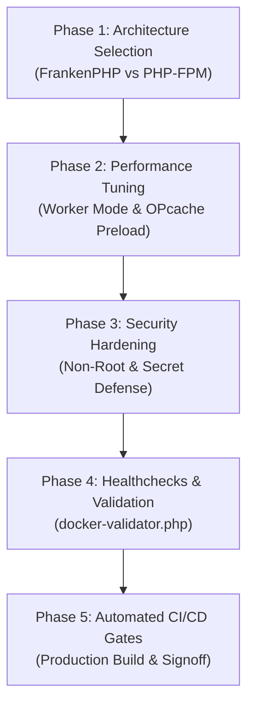

# Workflow: Containerization and Multi-Stage Production Deployment

## 1. Context and Objective
Establish an automated, hardened, high-performance containerization workflow for Symfony 6.4 LTS and 7.x+ applications utilizing multi-stage Docker builds, FrankenPHP (or PHP-FPM), Caddy web server, HTTP/3, and rootless security standards.

## 2. Participating Specialists
- `symfony-architect`: Defines container architecture, service contracts, and volume persistence policies.
- `symfony-performance-specialist`: Configures FrankenPHP worker mode, OPcache preloading, and memory limits.
- `security-engineer`: Audits Dockerfiles for rootless execution, secret leakage, and security headers.
- `quality-engineer`: Validates automated healthchecks and verifies integration with `docker-validator.php`.
- `orchestrator`: Validates CI/CD quality gates and provides formal deployment signoff.



---

## 3. Operational Phases

### Phase 1: Architecture Selection & Scaffolding
1. Choose between **FrankenPHP** (recommended default: embedded Caddy, HTTP/3, worker mode) or traditional **PHP-FPM** (Nginx sidecar).
2. Scaffold container manifests:
   - `templates/docker/Dockerfile.frankenphp`
   - `templates/docker/Caddyfile.dist`
   - `templates/docker/compose.yaml.dist`
   - `templates/docker/docker-entrypoint.sh`

### Phase 2: Performance Tuning & Worker Mode
1. Configure worker mode in `Caddyfile`:
   ```caddyfile
   frankenphp {
       num_threads auto
       worker {
           file /app/public/index.php
           num auto
           env APP_RUNTIME "Runtime\\FrankenPhpSymfony\\Runtime"
       }
   }
   ```
2. Enable OPcache preloading in production target:
   ```dockerfile
   RUN echo "opcache.preload=/app/config/preload.php" >> "$PHP_INI_DIR/conf.d/docker-php-ext-opcache.ini" && \
       echo "opcache.preload_user=www-data" >> "$PHP_INI_DIR/conf.d/docker-php-ext-opcache.ini"
   ```
3. Set production memory limits (`memory_limit = 256M`, `max_execution_time = 60`).

### Phase 3: Security Hardening & Rootless Execution
1. Ensure the production image drops privileges to unprivileged `www-data` (`USER www-data`).
2. Enforce strict HTTP security headers in Caddyfile:
   - `Strict-Transport-Security` (HSTS)
   - `X-Content-Type-Options: nosniff`
   - `X-Frame-Options: DENY`
   - `Referrer-Policy: strict-origin-when-cross-origin`
3. Prevent information disclosure by enforcing `expose_php = Off`.
4. Validate that no sensitive secrets (`APP_SECRET`, database passwords) are baked into Dockerfile layers.

### Phase 4: Container Healthchecks & Validation
1. Verify automated container healthchecks:
   ```dockerfile
   HEALTHCHECK --interval=10s --timeout=3s --start-period=15s --retries=3 \
       CMD curl -f http://localhost:80/up || exit 1
   ```
2. Execute automated container architecture validator:
   ```bash
   php templates/docker/docker-validator.php --strict
   ```

### Phase 5: CI/CD Build & Production Signoff
1. Verify Dockerfile syntax and build reproducibility:
   ```bash
   docker build --target prod -f templates/docker/Dockerfile.frankenphp -t symfony-app:prod .
   ```
2. Verify all quality gates pass in CI/CD pipeline before releasing container artifacts to production registries.
