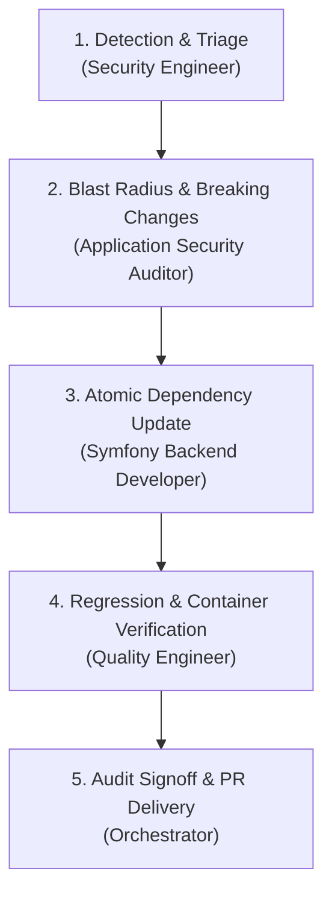

# Workflow: Automated Dependency CVE Remediation

## 1. Objective
Safely patch, update, and remediate known third-party dependency vulnerabilities (CVEs and GHSAs) detected in `composer.lock` without introducing breaking changes, contract regressions, or container instantiation failures.

---

## 2. Participating Engineering Specialists



| Specialist Role | Operational Responsibility in Workflow |
| :--- | :--- |
| **`security-engineer`** | Executes `composer audit` and `cve-remediator.php`, triages severity (CVSS score), and verifies advisory details. |
| **`application-security-auditor`** | Inspects where the vulnerable package is imported in the codebase and assesses potential exploitability. |
| **`symfony-backend-developer`** | Executes targeted atomic upgrades (`composer update <pkg> --with-dependencies`) and adapts code if deprecations arise. |
| **`quality-engineer`** | Runs container linter, static analysis (`phpstan`), and automated tests (`WebTestCase`) to guarantee zero regressions. |
| **`orchestrator`** | Consolidates before-and-after audit logs and opens the security pull request. |

---

## 3. Operational Phases

### Phase 1: Vulnerability Detection & Triage
1. Run automated CVE scan:
   ```bash
   php templates/security/cve-remediator.php --output-json=var/security/cve-report.json
   ```
2. If vulnerabilities exist:
   - Identify affected packages and advisory IDs.
   - Record minimum fixed version from advisory metadata.

### Phase 2: Blast Radius Analysis
1. Inspect package usage across `src/` and `config/`:
   ```bash
   composer why vendor/package-name
   ```
2. Determine if the vulnerable code path is reachable by untrusted input or active service configurations.

### Phase 3: Atomic Dependency Update
1. Update exclusively the targeted vulnerable package:
   ```bash
   composer update vendor/package-name --with-dependencies
   ```
2. Avoid generic `composer update` without arguments to keep diffs isolated and auditable.

### Phase 4: Automated Verification Gates
Execute all local validation gates:
1. Validate container integrity:
   ```bash
   php bin/console lint:container
   ```
2. Validate Doctrine schema:
   ```bash
   php bin/console doctrine:schema:validate
   ```
3. Run static analysis:
   ```bash
   vendor/bin/phpstan analyse --level=8
   ```
4. Run full test suite:
   ```bash
   php bin/phpunit --testdox
   ```

### Phase 5: Re-Audit and Verification Signoff
1. Confirm zero remaining CVEs:
   ```bash
   php templates/security/cve-remediator.php
   ```
2. Output clean pass evidence in pull request description.
