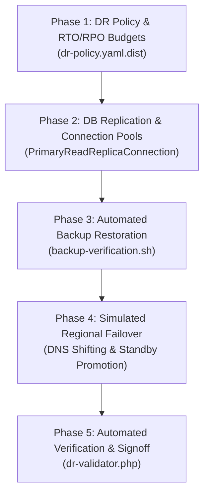

# Workflow: Enterprise Disaster Recovery (DR) & Multi-Region Failover

## 1. Context and Objective
Establish an enterprise operational workflow to handle regional catastrophic outages, continuous PostgreSQL streaming replication failovers, and automated backup restoration drills within strict RTO (< 5 minutes) and RPO (< 1 minute) SLA budgets.

## 2. Participating Specialists
- `symfony-architect`: Sizing cross-region primary/standby architecture and authoring DNS shifting policies.
- `database-engineer`: Configuring Doctrine PrimaryReadReplica connection pools and monitoring replication lag.
- `database-performance-specialist`: Calibrating query timeouts, circuit breakers, and connection pool saturation.
- `security-engineer`: Auditing cross-region KMS encryption and validating backup cryptographic signatures.
- `quality-engineer`: Executing automated backup verification drills (`backup-verification.sh`).
- `orchestrator`: Coordinating simulated DR drills and authorizing production regional promotion.



---

## 3. Operational Phases

### Phase 1: DR Policy & RTO/RPO SLA Calibration
1. Establish recovery parameters in `templates/disaster-recovery/dr-policy.yaml.dist`:
   - Tier 1 (Checkout, Core API): **RTO <= 300s (5m)**, **RPO <= 60s (1m)**.
   - Tier 2 (Async Workers, Reports): **RTO <= 3600s (1h)**, **RPO <= 900s (15m)**.
2. Define primary and secondary regions (`sa-east-1` Primary, `us-east-1` Hot Standby).

### Phase 2: Database Replication & Connection Pooling
1. Configure Doctrine DBAL with `PrimaryReadReplicaConnection` (`templates/disaster-recovery/doctrine-multiregion.yaml.dist`).
2. Implement automatic read/write decoupling:
   - Modifying queries (`INSERT`, `UPDATE`, `DELETE`) and transactions -> Primary.
   - Read-only operations (`SELECT`) -> Local and cross-region replicas.
3. Enforce strict connection timeout safeguards (`connect_timeout: 3`) to detect network partitions immediately.

### Phase 3: Automated Backup Restoration & Integrity Testing
1. Run automated daily restoration verification drill:
   ```bash
   bash templates/disaster-recovery/backup-verification.sh backups/latest.sql.gz var/report.json
   ```
2. Verify:
   - Cryptographic SHA256 checksum matches recorded manifest.
   - Database restore completes without fatal SQL errors.
   - Doctrine schema passes integrity checks (`doctrine:schema:validate`).

### Phase 4: Simulated Regional Failover & DNS Shifting
1. Simulate regional primary failure during scheduled maintenance window.
2. Promote hot standby PostgreSQL replica to primary read/write.
3. Update DNS latency routing (Route53 / Cloudflare) to route traffic to the secondary region.
4. Verify traffic recovers within the 300-second RTO budget.

### Phase 5: Verification & DR Compliance Signoff
1. Execute automated DR architecture validator:
   ```bash
   php templates/disaster-recovery/dr-validator.php --strict
   ```
2. Archive drill report in `var/backup-verification-report.json`.
3. Provide formal compliance signoff by `orchestrator`.
