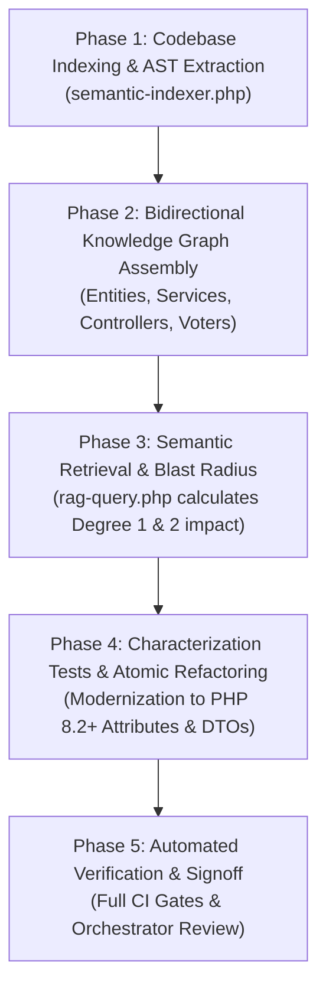

# Workflow: Codebase Semantic Indexing, Knowledge Graph RAG & Blast Radius Refactoring

## 1. Context and Objective
Establish an autonomous codebase indexing, semantic retrieval, and blast-radius analysis workflow for large-scale and legacy Symfony applications. Empowers agents to navigate millions of lines of PHP code, assess the ripple effect of modifications, and refactor legacy patterns into PHP 8.2+ and Symfony 6.4/7+ with zero regressions.

## 2. Participating Specialists
- `project-analyst`: Generates AST extraction and builds the codebase knowledge graph (`semantic-indexer.php`).
- `refactoring-specialist`: Executes blast radius impact queries and formulates modernization plans (`rag-query.php`).
- `symfony-architect`: Validates architectural decoupling and establishes immutable DTO boundaries.
- `quality-engineer`: Locks existing behavior with characterization tests prior to refactoring.
- `orchestrator`: Validates refactoring diffs, verifies CI quality gates, and authorizes integration.



---

## 3. Operational Phases

### Phase 1: Codebase Indexing & AST Extraction
1. The `project-analyst` executes semantic AST extraction across the repository:
   ```bash
   php templates/rag/semantic-indexer.php --source=src --output-graph=templates/rag/knowledge-graph.json.dist --strict
   ```
2. Extracted entities:
   - Classes, namespaces, interfaces, and traits.
   - Native PHP 8 attributes (`#[Route]`, `#[ORM\Entity]`, `#[MapRequestPayload]`).
   - Legacy annotations (`@Route`, `@ORM\`) flagged as technical debt.
   - Constructor parameter injections and dependency chains.

### Phase 2: Knowledge Graph Assembly & Edge Mapping
1. Assembles nodes into the JSON ontology schema:
   - Entity -> Table, properties, and relationships.
   - Controller -> Route paths, HTTP methods, and firewall rules.
   - Service -> Contracts and injected dependencies.
   - Voter -> Protected entities and permissions.
   - Messenger -> Dispatched notifications and consumer handlers.
2. Computes normalized semantic embedding vectors for cosine similarity search.

### Phase 3: Semantic Retrieval & Blast Radius Analysis
1. When asked to refactor or modernize a legacy component, `refactoring-specialist` runs:
   ```bash
   php templates/rag/rag-query.php --query="order checkout" --blast-radius="App\Entity\Order" --strict
   ```
2. Evaluates the ripple effect:
   - **Degree 1 (Direct Impact):** Repositories querying the entity, Controllers exposing it, Voters protecting it.
   - **Degree 2 (Transitive Impact):** Upstream API consumers, event listeners, background workers.

### Phase 4: Characterization Testing & Atomic Refactoring
1. `quality-engineer` writes `WebTestCase` characterization suites verifying external behavior of all Degree 1 callers before any edit.
2. `refactoring-specialist` applies modernization:
   - Migrates Doctrine and routing annotations to PHP 8.2+ attributes.
   - Replaces untyped controller arrays with immutable `#[MapRequestPayload]` DTOs.
   - Introduces explicit Fetch Joins in QueryBuilders to eliminate N+1 queries.

### Phase 5: Automated Verification & Refactoring Signoff
1. Executes local verification gates:
   - `lint:container` & `doctrine:schema:validate`.
   - Static analysis: `vendor/bin/phpstan analyse --level=8`.
   - Automated tests: `php bin/phpunit`.
2. `orchestrator` reviews the git diff against the blast radius plan and issues final release signoff.
