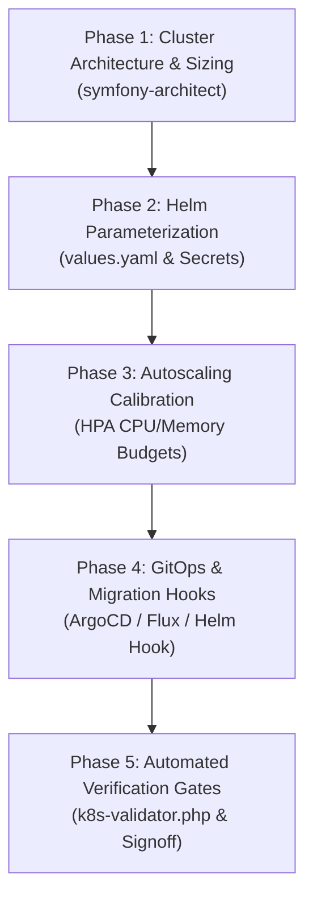

# Workflow: Kubernetes Helm & GitOps Continuous Deployment

## 1. Context and Objective
Establish an automated cloud-native deployment workflow for Symfony applications on Kubernetes using Helm charts, GitOps delivery (ArgoCD / Flux CD), Horizontal Pod Autoscaling (HPA), and automated database schema migration jobs.

## 2. Participating Specialists
- `symfony-architect`: Sizing container limits, defining Ingress contracts, and volume persistence topology.
- `symfony-performance-specialist`: Calibrating HPA targets (CPU/Memory) and scaling background Messenger workers.
- `security-engineer`: Auditing CIS Kubernetes security benchmarks, non-root pods, and secret references.
- `quality-engineer`: Validating Helm templates and executing `k8s-validator.php` in CI/CD pipelines.
- `orchestrator`: Conducting deployment readiness reviews and authorizing GitOps sync policies.



---

## 3. Operational Phases

### Phase 1: Cluster Architecture & Resource Sizing
1. Establish compute quotas based on performance profiling:
   - Web application: Requests `200m CPU / 256Mi RAM`, Limits `1000m CPU / 512Mi RAM`.
   - Messenger workers: Requests `100m CPU / 128Mi RAM`, Limits `500m CPU / 256Mi RAM`.
2. Configure rolling updates in `deployment-web.yaml`:
   ```yaml
   strategy:
     type: RollingUpdate
     rollingUpdate:
       maxSurge: 25%
       maxUnavailable: 0
   ```

### Phase 2: Helm Parameterization & Security Context
1. Enforce CIS Kubernetes benchmarks in `values.yaml`:
   ```yaml
   podSecurityContext:
     runAsNonRoot: true
     runAsUser: 33 # www-data
     fsGroup: 33
   securityContext:
     allowPrivilegeEscalation: false
     capabilities:
       drop:
         - ALL
   ```
2. Configure liveness, readiness, and startup probes targeting `/up`.

### Phase 3: Autoscaling Calibration (HPA)
1. Configure `HorizontalPodAutoscaler` (`autoscaling/v2`):
   ```yaml
   autoscaling:
     enabled: true
     minReplicas: 2
     maxReplicas: 10
     targetCPUUtilizationPercentage: 75
     targetMemoryUtilizationPercentage: 80
   ```
2. Enable `PodDisruptionBudget` to guarantee high availability during cluster maintenance:
   ```yaml
   podDisruptionBudget:
     minAvailable: 1
   ```

### Phase 4: GitOps & Database Migration Hooks
1. Execute database migrations safely using Helm lifecycle hooks (`templates/job-migration.yaml`):
   ```yaml
   annotations:
     "helm.sh/hook": post-install,post-upgrade
     "helm.sh/hook-delete-policy": before-hook-creation,hook-succeeded
   ```
2. Commit ArgoCD Application CRD (`templates/kubernetes/gitops/argocd-application.yaml.dist`) with automated prune and self-heal policies.

### Phase 5: Automated Verification & Signoff
1. Run automated Kubernetes architecture validator:
   ```bash
   php templates/kubernetes/k8s-validator.php --strict
   ```
2. Verify linting via Helm CLI if available:
   ```bash
   helm lint templates/kubernetes/helm/symfony-app
   ```
3. Issue deployment signoff and trigger GitOps synchronization.
