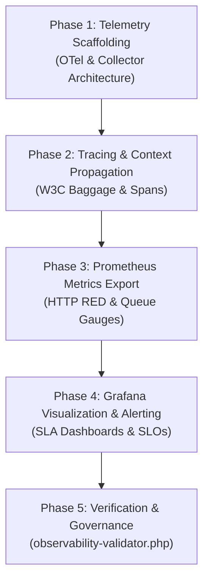

# Workflow: Observability, OpenTelemetry Tracing & Metrics Monitoring

## 1. Context and Objective
Establish an enterprise observability lifecycle for Symfony applications incorporating OpenTelemetry distributed tracing, Prometheus RED metrics (Rate, Errors, Duration), and Grafana executive and engineering dashboards.

## 2. Participating Specialists
- `symfony-architect`: Sizing OTel Collector pipelines and defining W3C trace propagation policies.
- `symfony-backend-developer`: Enriching spans with business attributes (e.g. `order.id`, `customer.tier`) and sanitizing sensitive data.
- `symfony-performance-specialist`: Calibrating Prometheus scraping intervals, bucket thresholds, and OPcache gauges.
- `quality-engineer`: Validating PromQL expressions and verifying dashboard rendering with `observability-validator.php`.
- `orchestrator`: Conducting observability reviews and validating alerting SLO/SLA thresholds.



---

## 3. Operational Phases

### Phase 1: Telemetry Scaffolding & Collector Sizing
1. Deploy OpenTelemetry Collector configuration (`templates/observability/otel-collector-config.yaml.dist`).
2. Sizing buffers and processors:
   - `memory_limiter`: Drops spans safely at 80% memory consumption.
   - `batch`: Flushes every 1024 spans or 1 second to minimize HTTP round-trips.

### Phase 2: OpenTelemetry Tracing & Span Enrichment
1. Install and configure OpenTelemetry PHP SDK (`templates/observability/otel.yaml.dist`).
2. Configure auto-instrumentation spans:
   - HTTP requests & responses.
   - Doctrine DBAL queries (with parameter sanitization).
   - Symfony Messenger message dispatch & consumer execution.
   - HttpClient outgoing HTTP requests.
3. Propagate W3C Trace Context (`traceparent` and `tracestate`) across asynchronous queues and microservices.

### Phase 3: Prometheus Metrics Export & Queue Monitoring
1. Expose Prometheus metrics at `/metrics` using `templates/observability/prometheus.yaml.dist`.
2. Ensure metrics follow standard naming:
   - `symfony_http_requests_total`
   - `symfony_http_request_duration_seconds`
   - `symfony_database_queries_total`
   - `symfony_database_query_duration_seconds`
   - `symfony_messenger_queue_size`

### Phase 4: Grafana Visualization & Alerting
1. Provision Grafana dashboard from [symfony-dashboard.json](file:///d:/gow/symfony-engineering-agent-v2.0/symfony-engineering-agent/templates/observability/grafana/symfony-dashboard.json).
2. Configure alert thresholds:
   - Critical: HTTP Availability < 99.0% over 5m.
   - High: P95 Request Latency > 300ms over 5m.
   - High: Messenger Queue Backlog > 1000 messages for 10m.

### Phase 5: Automated Verification & Signoff
1. Execute automated observability architecture validator:
   ```bash
   php templates/observability/observability-validator.php --strict
   ```
2. Verify trace continuity end-to-end:
   - Trigger test API request -> Verify trace appears in Tempo / Jaeger.
   - Verify metrics scrape successfully in Prometheus.
3. Final signoff by `orchestrator`.
