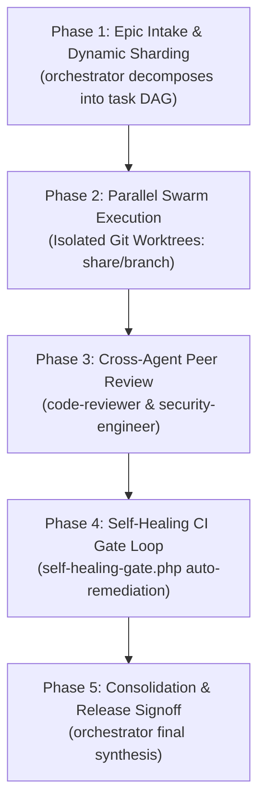

# Workflow: Autonomous Multi-Agent Swarm Orchestration & Self-Healing CI

## 1. Context and Objective
Orchestrate large-scale, enterprise-level Symfony 6.4/7+ feature development using an autonomous swarm of 20 specialized engineering agents. Features dynamic task sharding across bounded contexts and architectural layers, parallel worker execution in isolated Git worktrees, peer code review gates, and an autonomous self-healing CI remediation loop.

## 2. Participating Specialists
- `orchestrator`: Master Swarm Coordinator. Shards epics, resolves dependencies, monitors progress board, and synthesizes final release.
- **Architecture Cluster:** `symfony-architect` (Lead), `project-analyst`, `project-bootstrapper`.
- **Backend & Persistence Cluster:** `symfony-backend-developer` (Lead), `database-engineer`, `integration-specialist`.
- **Quality Cluster:** `quality-engineer` (Lead), `code-reviewer`, `debugger`, `refactoring-specialist`, `technical-writer`.
- **Security Nucleus Cluster:** `security-engineer` (Lead), `symfony-security-specialist`, `php-security-specialist`, `application-security-auditor`.
- **High-Performance Cluster:** `performance-engineer` (Lead), `symfony-performance-specialist`, `database-performance-specialist`, `php-performance-specialist`.



---

## 3. Operational Phases

### Phase 1: Epic Intake & Dynamic Task Sharding
1. Coordinator parses user epic and selects the optimal sharding strategy (`domain_driven`, `layer_driven`, or `verification_driven`).
2. Generates an acyclic task dependency graph (DAG) mapping each task slice to a specialized agent role, workspace isolation mode (`inherit`, `share`, or `branch`), and output contract.
3. Publishes tasks to the Swarm Event Bus in `queued` state.

### Phase 2: Parallel Swarm Execution in Isolated Worktrees
1. Agents assigned to authoring tasks (`symfony-backend-developer`, `database-engineer`, `symfony-security-specialist`) work concurrently in isolated Git worktrees (`workspace: "branch"`).
2. Contracts and DTOs established by `symfony-architect` are shared across workers via read-only access.
3. Event states transition: `queued` -> `assigned` -> `in_progress` -> `verified`.

### Phase 3: Cross-Agent Peer Review & Diff Audit
1. Prior to merging any branch into the main integration branch, `code-reviewer` and `application-security-auditor` perform independent diff analysis.
2. Checks enforced:
   - Zero anti-AI patterns (no fake methods, no superficial mock logic).
   - Strict typing (`declare(strict_types=1);`, immutable DTOs).
   - IDOR prevention and Voter enforcement.
   - Zero N+1 queries in Doctrine repositories.

### Phase 4: Autonomous Self-Healing CI Gate Loop
1. Automated CI quality gates run via `templates/swarm/self-healing-gate.php`:
   ```bash
   php templates/swarm/self-healing-gate.php --strict --max-retries=3
   ```
2. When a gate fails:
   - Failure output is parsed and mapped to the responsible specialist agent.
   - `debugger` reproduces the failure with an automated regression test.
   - Assigned specialist applies a minimal atomic patch.
   - The gate re-executes. Up to 3 attempts allowed before escalation.

### Phase 5: Deliverable Synthesis & Release Signoff
1. The coordinator verifies that all tasks in the DAG are `completed`.
2. Validates container compilation (`lint:container`), static analysis (PHPStan Level 8+), and full test coverage.
3. Merges verified worktrees into the main branch and issues formal release signoff.
